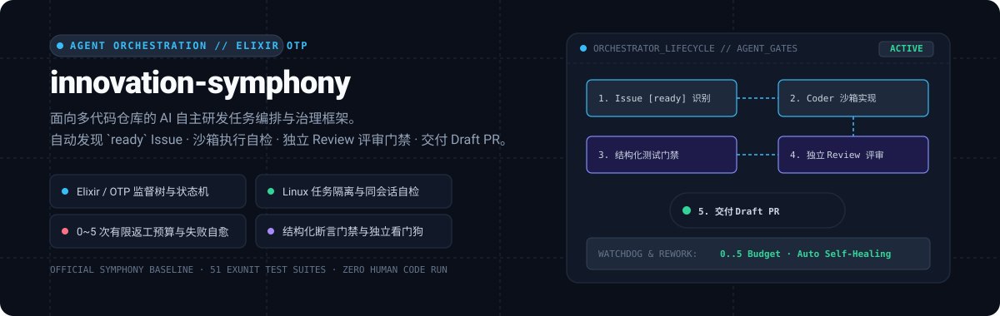

# innovation-symphony

<div align="center">
  
</div>

<p align="center">
  <a href="#核心工作流程"><strong>核心工作流</strong></a> ·
  <a href="#四大工程保障机制"><strong>工程保障机制</strong></a> ·
  <a href="#可观测性看板-view"><strong>只读看板</strong></a> ·
  <a href="#工程演进与里程碑契约"><strong>契约与演进</strong></a> ·
  <a href="#原型预览与文档导航"><strong>文档索引</strong></a>
</p>

---

innovation-symphony 基于官方 [Symphony](https://github.com/openai/symphony) 的 Elixir 实现，自动发现带 `ready` 标签的 Issue，完成编码、正式检查、独立 Review，并交付待人工合并的 Draft PR / MR。目前单实例处理一个仓库、同时执行一个任务；多仓库调度仍不在当前范围。

2026-10-21，本机服务已迁入独立 QEMU/KVM VM，接入 `innovation/luca`。GL-4 已完成真实 Docker 正式检查及 Reviewer 批准，交付 [Draft MR !3](https://81.71.154.125:8443/innovation/luca/-/merge_requests/3)。前段两次部署故障经过人工审计接续，不能登记为首次 ready 后全程无人干预通过。准确版本、工具链、测试与剩余人工验收见 [VM 部署记录](docs/VM_DEPLOYMENT.md)。

本机入口为 [控制器](http://127.0.0.1:4000/)、[View](http://127.0.0.1:8613/) 和需鉴权的模型设置后端 `127.0.0.1:8765`，均通过 SSH 隧道连接 guest loopback。运行 release 为 `9cf6c1701f26-20261021`；其源码是远端 main 的 PR #20 合并提交 `9cf6c17`；后续文档提交与运行代码分别记录。

---

## 核心工作流程

```text
在目标仓库创建 Issue (明确需求规格)
  │
  ├─► (可选) 评论区通过约定指令指定 Coder / Reviewer 模型
  ▼
添加 ready 标签
  │
  ▼
Symphony 监听器自动捕获并认领任务 (无须人工指派 Bot)
  │
  ▼
Coder 在专用 VM 内编码、安装依赖并完成同会话自检
  │
  ▼
控制器对准确候选执行冻结的全部正式检查，保存日志及结果
  │
  ▼
独立只读 Reviewer 检查 diff、合同与本候选正式检查证据
  │
  ├─► [代码拒绝] 在冻结恢复预算内返工，再完整检查与 Review
  ├─► [外部条件] awaiting_external；待验收 Draft 不算批准交付
  ▼
[全部通过] 自动发布 Reviewer 批准的 Draft PR / MR (附完整回执)
  │
  ▼
由人工工程师进行最终审核、合并与版本升级
```

- **工作流状态**：以 `ready`、`review`、`blocked` 等标签作为基本状态机锚点；
- **模型路由**：每个仓库可单独配置编码与评审的默认模型；用户在 Issue 评论中显式指定具有最高优先级；未指定时自动沿用仓库默认配置；
- **边界原则**：各仓库任务完全独立处理，不进行跨仓库的扩散修改；合并操作与版本发版由人类工程师主导，系统不自动追赶 main 分支。

---

## 四大工程保障机制

### 1. 独立 VM 与同会话自检
当前部署为 Ubuntu 24.04、8 vCPU、12 GiB 内存和 50 GiB 虚拟磁盘。控制器、模型客户端、Docker 和工作区都在 VM 内，coder 可使用 sudo、安装依赖和启动临时服务；不共享宿主目录或 Docker socket。Reviewer/诊断使用独立只读会话。VM 内完全放权也允许任务影响同机控制器、凭据和证据，不承诺内部权限隔离；旧 rootless 合同另行保留。见 [执行环境准入](docs/EXECUTION_READINESS.md) 和 [Coder 执行规则](docs/CODER_EXECUTION_RULES.md)。

### 2. 有限返工预算与失败自动恢复 (IS-026)
系统引入了可控的自愈循环：因代码缺陷导致的技术失败可交回编码环境或发起只读诊断，普通修复窗口无需逐次请求人工审批。
- 当前新 VM 任务冻结四小时、30 次返工、96 次模型调用，任一上限耗尽即停止；正式检查单次上限 30 分钟并受剩余总预算约束。
- `resume_on_restart` 只对领取时明确冻结的新任务生效；重启不重置预算，未知模型用量或发布结果无法唯一对账时停止并保留证据。
- 检查日志、失败 attempt 与 Review 拒绝保留。旧 blocked 回执不自动复活；未启用 recovery 的旧配置仍沿用默认 0、显式 1..5 的旧合同。详见 [自动恢复合同](docs/AUTOMATIC_RECOVERY.md)。

### 3. systemd 托管与维护排空
宿主用户级 systemd 管理 QEMU、SSH 隧道、磁盘检查和每日备份；guest 系统级 systemd 管理三个原生应用服务。维护先暂停新领取，再取得绑定 nonce、进程和 boot ID 的排空确认。旧宿主控制器、View 和模型设置服务已停止并禁用；历史看门狗命令不适用于当前部署。见 [VM 运维入口](scripts/vm/README.md)。

### 4. 真实验收与端到端闭环实据
GitLab GL-4 的两项正式检查包含真实 Docker 构建与重启后的 `/api/version` 稳定性验证，Reviewer 批准 20 项验收后交付 Draft MR !3；人工合并尚未执行。早期 GitHub Issue #3 的恢复与 [Draft PR #4](https://github.com/dailiuyi/innovation-symphony/pull/4) 另见 [历史验收记录](docs/VALIDATION_AUTOMATIC_RECOVERY.md)。完整门禁、合成重启夹具和真实任务证据分开报告。

宿主 `/data/symphony-vm` 在授权清理 11 个失败归档及早期快照后，由约 51 GiB 降到 30 GiB，释放 20.52 GiB；VM 的 50 GiB 是虚拟磁盘容量上限。最终迁移归档和成功日备份保留，现有成功日备份早于 GL-4，清理不代表已生成交付后备份。清理清单及现存恢复源见 [部署记录](docs/VM_DEPLOYMENT.md#存储清理与现存恢复源2026-10-21)。

---

## 可观测性看板 (View)

项目在 [`view/`](view/README.md) 目录下集成了基于 Python 标准库构建的独立只读可观测采集与展示服务（可在本地通过 [http://127.0.0.1:8613/](http://127.0.0.1:8613/) 访问）。
- 看板独立维护本地数据、缓存与请求日志，其启动与停止完全不影响 Elixir 主调度控制器的运行；
- 提供 Linear 风格的任务四态看板、会话轨迹查询与只读上下文审查；
- 权限与安全边界明确：仅限内网使用，所有任务修改与执行权限严格收敛于 Elixir 核心。

---

## 工程演进与里程碑契约

- **GH-3（最小增量接管前只读体检）**：提供 `--preflight` 校验模式，严格校验状态机定义与远端 Issue 连通性，防止虚假报告通过。详见 [体检边界](docs/IMPLEMENTATION_V0.md#gh-3-最小增量接管前只读体检)；
- **GH-12（多模型服务路由）**：增加 Coder 与 Reviewer 的多模型预设管理，对任务领取时的完整配置进行参数冻结。详见 [角色模型服务](docs/MODEL_SERVICES.md)；
- **GH-16（看板双角色配置对接）**：在独立 View 设置页增加受控内网的仓库双角色默认选择，并支持 DeepSeek Responses 接入。详见 [方案及检查记录](docs/VIEW_MODEL_SETTINGS.md)；
- **Linux 补丁与审计记录**：详见 [本轮补丁验证](docs/VALIDATION_LINUX_PATCHES.md) 与 [实验性隔离规范](docs/ROOTLESS_OPEN.md)。

---

## 原型预览与文档导航

### 本地架构原型预览
在项目根目录下启动轻量 HTTP 服务即可预览前端控制台设计原型：

```bash
python3 -m http.server 43221 --bind 127.0.0.1 --directory prototypes
```

访问地址：<http://127.0.0.1:43221/symphony-dashboard.html>。

### 核心文档索引
- [文档总入口 (docs/README.md)](docs/README.md)
- [需求规格清单 (docs/REQUIREMENTS.md)](docs/REQUIREMENTS.md)
- [架构决策记录与替代方案 (docs/DECISIONS.md)](docs/DECISIONS.md)
- [当前 VM 部署、备份与清理记录 (docs/VM_DEPLOYMENT.md)](docs/VM_DEPLOYMENT.md)
- [VM 准备、检查、启停与恢复入口 (scripts/vm/README.md)](scripts/vm/README.md)
- [运行运维与维护手册 (docs/OPERATIONS.md)](docs/OPERATIONS.md)
- [Issue 协议规范草案 (docs/ISSUE_PROTOCOL.md)](docs/ISSUE_PROTOCOL.md)
- [第三方与官方上游基线对照 (docs/UPSTREAM.md)](docs/UPSTREAM.md)
