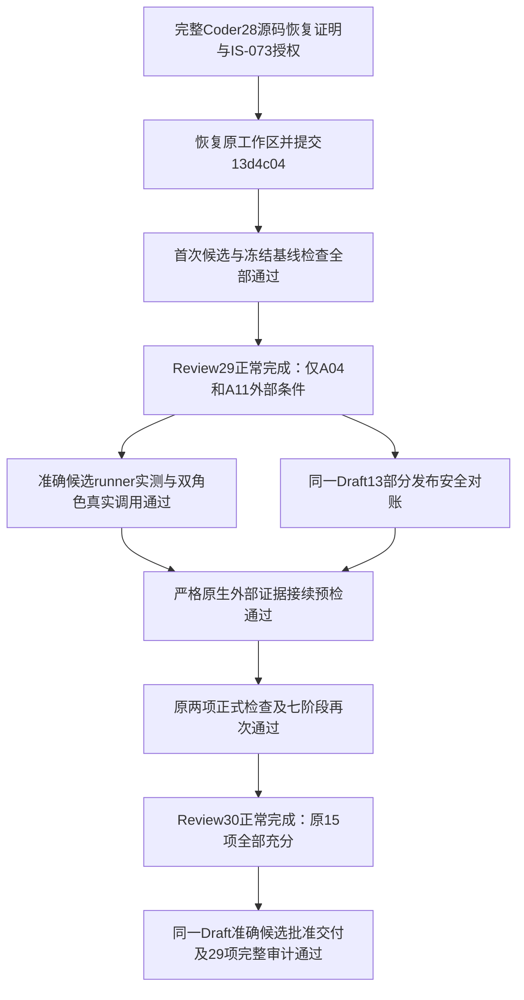
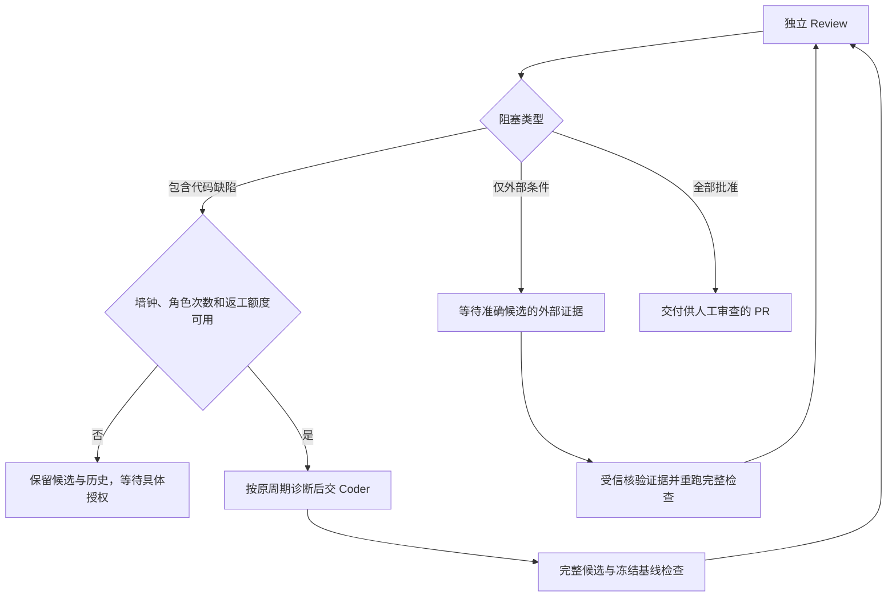

# Issue 12 会话与返工原因报告

最新CI修复结果（2026-10-07 12:42，北京时间）：补丁3857e73已普通快进推送至PR13，[run37571641245](https://github.com/dailiuyi/innovation-symphony/actions/runs/37571641245)的make-all和View均通过；远端736项测试0失败、6跳过，覆盖率100%，Dialyzer0错误，73项Python环境隔离测试通过。随后PR已合并为66b9b25，合并后main的run37572236294也全部通过。此前失败及原功能候选13d4c04的控制器审计保留；新SHA的CI通过不冒充旧Review30对新提交的独立批准。

后续CI核查（2026-10-07 12:09，北京时间）：[GitHub Actions run 37502364490](https://github.com/dailiuyi/innovation-symphony/actions/runs/37502364490/job/112402323133)的make-all失败，View通过。CI针对最终候选13d4c04；实际PR合并测试提交90b3834881edf5d74ec3af247987924b4e15d610与候选的源码tree均为04754d56fdd68dc3ab59019a4f4bdce10abfbc8d。六项真实Codex离线配置测试因runner缺少客户端失败，覆盖率99.98%低于100%；本机隔离执行器会把客户端挂载到/opt/codex，而GitHub工作流仅安装Elixir/Erlang，没有提供此新增依赖。同一源码在临时副本中对照复现：SYMPHONY_TEST_CODEX=/opt/codex（不存在）时6项全失败，指定本机codex-cli 0.160.0时6项全通过，无真实推理。此前29项审计覆盖本机验收与准确Draft交付，没有覆盖远端CI；所以首段的交付完成不能解释为PR全绿，远端CI仍待修复并全量重跑。旧回执、批准及审计证明保留，不据此手改任务状态或重置历史。

当前执行快照（2026-10-07 02:02，北京时间）：原Issue12已完成准确候选验收与同一Draft交付。最终候选13d4c04a1dd30c32a89058d6c14709e3c237da1a，第30次独立Review正常完成、approved=true、原15项验收全部充分、blockers为空；完整只读审计29／29通过。最终候选736项／0失败／6既有跳过、100%覆盖、Dialyzer0及格式／规格／Credo／构建通过，冻结基线669项／0失败／6跳过；正式七阶段及准确双角色真实GPT、实际候选runner内核证明均绑定同一完整SHA。Draft PR #13仍OPEN／Draft，远端head、分支、base和正文与已批准不可变intent完全一致，回执awaiting_human、交付approved，operator已成功闭合并释放锁，本机执行服务正常退出。IS-073窗口00:40:29.373—12:40:29.373，上限Agent39／返工12；实际收尾Agent30／返工9，本轮没有新增Coder。原全部失败、用量及历史保留。普通领取仍关闭，功能候选未合并或安装；既有基础设施安装与任务候选分开记录，真实重启、第二账号／服务商、无法确认的实际型号及网络遥测仍如实标为未验证或unknown。

此前轮次修复了操作者辅助流程的两个停点：角色探针把实际ERTS启动入口误判为不同工具链（调用前失败，原失败保留；更正后的版本／安装根／入口摘要及候选BEAM绑定校验通过，双角色实际Turn均完成）；证据打包器错误要求每个合成资源子报告都独立携带候选SHA（已改为核对准确候选summary、唯一子报告路径、运行条件绑定与摘要，不添加虚构原生字段）。同一Draft修订出现head已推进、正文仍旧的部分交付；已按不可变pending intent和唯一精确PR对账，原不确定发布结果保留。Draft #13 head和正文现均指向新候选，当时仍OPEN／Draft，尚未最终验收、合并或安装功能候选；最新完成结果见首段。

Coder21五个文件的日志重建副本已通过原Linux隔离全量门禁（725项测试、0失败、6既有跳过、100%覆盖率、Dialyzer／构建等通过），它是部分恢复验证，不能冒充原模型成功。新候选的完整正式检查、独立Review及准确SHA的外部证据导入已经执行；当时的Reviewer27拒绝两项代码缺陷，并判定A11准确候选runner证据不足。普通控制器已安装独立基础设施包（导出失败分类与同一Draft安全修订；694项测试0失败、100%覆盖率、Dialyzer0错误、6既有跳过），不包含Issue12功能候选。View的只读中断提示已上线。

控制器／View的用户持久启动配置已保存并通过systemd验证，当前运行进程保持原状；下次用户管理器启动／登录生效，真实重启尚未验证。root执行桥持久配置安装证明已产生，静态验证通过，安装前后原桥进程身份和payload保持；下次启动生效，真实开机仍未验证。普通领取仍关闭；未合并或安装功能候选。

本报告供项目所有者判断应补齐哪些运行条件和架构接缝，以减少重复编码、检查重跑和人工接续。分析范围为当前 Linux 实例的 Issue #12 全部已采集会话、原始 rollout、控制器回执、正式检查、初始三轮及后续全部独立 Review、接续审计、沙箱完成报告，以及远端 Draft PR。核对日期已追加至 2026 年 10 月 7 日，时间均为北京时间。以下原分析采用当日约 13:02 的快照；IS-068 授权后的新验证和修复单列于文末，后续发现以该补充记录为准。

核心结论：初始13:02快照的多次会话由环境启动失败、两个单次会话超时、一次操作者入口错误、资源争用，以及两轮实质代码返工共同造成。后续真实接入又暴露模型容量、兼容实现和导出停点，均在文末按证据追加。不能把所有会话都算作 Review 返工，也不能把所有代码缺陷归因于外部环境。当前最值得补齐的是准确候选的受信外部验收阶段，以及实际协议和旧配置兼容合同；资源与时限底座已有本机修复和安装验证。

初次报告阶段只进行了分析和保存。随后 IS-068 授权了必要的本地修复和原任务补证接续；具体执行状态见文末及 OPERATIONS，不把建议或工程参数追认为永久产品决定。

## 本轮已完成的衔接

以下是原GH-12本次专用恢复链的实际阶段；调度、编码、正式检查、Review、恢复和交付继续使用原Elixir流程。准确候选探针由本机固定验收程序补证，通用产品的自动外部验收阶段仍待实现。最后两步现已有独立Review和完整审计实证，不能仅由前面通过结果推定。

若独立Review发现真实代码缺陷，原控制器在本次剩余额度内回流Coder；仅缺外部证明时补证并复审。任何新候选都需要重新绑定适用证据。扩额不会把有效拒绝改成通过；本轮恢复辅助工具的失败也没有被算成新增代码返工。

## 第29次尝试时的全量分类核对

[不可变尝试清单](../.local/external-issue12-20261007/attempt-inventory-29.json)核对原回执事件、各attempt的outcome和Review原输出；初始第1次是历史v0记录，未出现在后续Recovery.started事件中，已单独计入。累计29次为Coder14／Review12／诊断3，控制器返工计数9。这些是不同维度，均不能直接当作独立代码缺陷数量。该表统计控制器Agent预算内的任务尝试；独立验收探针及操作者只读校验另列，不代表账号的全部模型请求总数。

| 尝试类型 | 次数 | 准确尝试编号及含义 |
| --- | ---: | --- |
| Coder正常模型完成并被原执行路径接收 | 5 | 4、7、10、16、22；其正式检查与独立Review另外核对。 |
| Coder启动／单次时限／合同修复停点 | 5 | 1为历史namespace启动失败；2、6、15为单次超时或预算终止；3由操作者停止以恢复正式检查合同。具体不同限制见原时间线，不统称代码错误。 |
| Coder宿主关机中断 | 1 | 21；保留真实中断，恢复副本不冒充原Turn完成。 |
| Coder模型已完成但导出失败 | 3 | 19、25、28；原生失败保留，源码恢复和重新正式检查单独证明。具体拒绝条目仍未知。 |
| 正常Review发现至少一项代码阻塞 | 7 | 5、8、14、17、20、23、27；同一根因可能影响多个验收行，不按行数累加返工。 |
| 正常Review仅要求外部证明 | 3 | 11、26、29；应采集准确候选证明再独立复审，不因此派Coder。 |
| Review执行／终态协议失败 | 2 | 12、13；不构成有效代码拒绝，原模型容量与终态处理证据见原记录。 |
| 周期性诊断 | 3 | 9、18、24；是已有恢复合同中的角色调用，不是新的需求或独立返工轮。 |

对下一步优化的意义：应先减少执行边界和接续流程造成的往返，再补真实客户端兼容、撤权和凭据启动合同；真实代码拒绝仍需要Coder。外部验收必须固定到最终候选，新提交会使旧证据失效；反复Review旧证据不能解决这个问题。预算展示要分别列墙钟、Agent、Coder、Review、诊断和返工，才能准确解释“为什么Coder没有再次接收”。

## 当前补齐清单与实施状态

| 补齐对象 | 能减少哪类往返 | 已完成与仍待完成的边界 |
| --- | --- | --- |
| 受管 Linux 执行条件、线程预算、检查互斥和源码树外私有 TMPDIR | namespace 启动失败、PID／线程争用、临时夹具碰撞、连锁超时 | 四个 root 受信脚本已安装并通过真实嵌套 VM、持锁、隔离和清理实测；既有故障记录保留。本次重启实证表明临时 systemd 单元不会自动重建；已恢复既有安装并核对摘要。控制器／View持久用户单元已保存，root桥持久单元已安装并通过静态验证，原进程身份和payload未变；真实重启仍待验证。 |
| 原控制器执行合同、单次时限及真实 Turn 失败传播 | 停止新领取误清空检查、启动时限超过 bridge 限制、服务端失败被当格式错误重试 | 694项门禁对应新基础设施固定包已安装（含导出失败分类与安全Draft修订）。普通领取关闭与原任务接续分别执行；不含 #12 功能候选安装。 |
| 真实客户端配置合同与完整兼容矩阵 | mock 测试通过后才发现 provider、URL、CLI 或 TOML 兼容缺陷 | 功能修复已进入原候选链，最新两项旧配置缺陷由 Coder21部分处理、Coder22接续完成；完整协议和兼容矩阵仍应作为长期基础补齐。通过测试数量不证明遗漏组合不存在。 |
| 准确候选的受信双角色 GPT 与内核验收阶段 | Review 只有外部阻塞时停到操作者、旧证据随新提交失效 | IS-073已对新候选13d4c04实际执行root-owned候选runner并通过只读／网络／凭据／PID／清理验收；源码及BEAM准确绑定的双角色真实GPT调用也已正常完成。严格原生外部接续的完整门禁已通过，Review30批准原15项，最终完整审计29／29通过；旧候选证据、失败、未知项保留，通用产品自动阶段仍未实现。 |
| 导出诊断与可验证源码恢复 | 模型已完成却因导出失败被迫从头编码 | Coder19失败保留；独立重建、自测、安全导出及294跟踪文件核对已使原成果回到正式检查。具体原导出失败条目仍未知。现已本地修复“清理完成／导出失败”原因混淆，26项沙箱回归通过，该诊断修订已安装到普通控制器；更细导出条目诊断仍待补齐。 |
| 日志恢复的完整变更合同 | 模型成果已存在却因恢复副本缺步骤产生伪代码失败、误申请更多Coder | 本次证明turn/diff仅记录FileChange，遗漏已完成的Shell/Python改写。恢复必须按完成事件顺序处理白名单文件、安全字面量改写及固定formatter，再做独立门禁；不能凭最后RPC diff或单个blob摘要断言完整最终源码。v2完整重建已通过独立门禁与安全导出，六个恢复文件和289个未改动文件核对通过；IS-073已恢复至原任务并进入正式检查。首副本及其失败保留。 |
| 同一 Draft PR 的修订交付合同 | 已有 Draft 停在旧提交，后续候选发布被拒或并发修改被覆盖 | 本地修复45项交接测试通过，当前专用operator使用该修复；核验前序证明、祖先关系、唯一Draft及精确分支lease。该项新修订现已安装到普通控制器；本次Issue专用operator的固定源包和审计不变。 |
| 分维度预算展示和受审计增额入口 | 有墙钟却因Coder／返工耗尽停住、每次临时手写接续 | 本次3轮增额及角色上限已生效，原历史保留；通用入口和View展示仍是建议，未变更永久限额。 |
| 内容和工具链绑定的自检缓存、失败后尽早收尾 | 无变化重建PLT、已知覆盖失败后仍跑昂贵阶段 | 本次未修改正式门禁或复用不同候选的结果。需单独设计缓存键、失效条件和自检策略，最终正式检查仍完整执行。 |

## 18:52 检查结果与当时接续条件

用户已批准有界接续并要求增加 60 分钟时长；按 IS-069，实际恢复起算四小时已经生效，窗口为 17:57:34.629—21:57:34.629。Coder16 已完成第 6 轮，新候选为 `d20c57463835be833d9a55d2495d7123689cc9e8`。控制器正式候选 719 项、冻结基线 669 项均 0 失败、6 既有外部跳过；候选覆盖率 100%，格式、规格、严格 Credo、Dialyzer（0 错误）和构建通过。两项正式客体均退出 0，清理、后代、导出和后台输出关闭全部为 true，PID 超限／OOM 为零。

18:44:33.985，独立 Reviewer17 拒绝 A01 一项代码缺陷，并保留 A04／A11 两项准确候选外部验证。新缺陷是旧非隔离配置解析白名单遗漏原生顶层 `openai_base_url`／`chatgpt_base_url`，令原可由客户端读取的明确连接配置变成 `legacy_model_service_migration_required`；这不是原连接资料缺失。准确候选源码和加载 BEAM 已绑定的[合成配置复现](../.local/external-issue12-20261005/candidate-d20c574-20261005/legacy-top-level-read-repro.json) SHA256 `7d965805a38a75822043f97a73c196a67e61d1c9e1c33898b2a15823e34e1bea`，四项结果为：旧 effort 控制通过、两个原生 URL 配置各自拒绝、旧隔离路径忽略 auth_home 配置仍通过。该复现不调用 GPT、不修改候选或真实账号配置。

控制器按混合阻塞先修代码的合同尝试回流，但下一轮将是 round 7，超过已批准 `max_rework=5` 对应的最多六轮，因而停在 `blocked / :mvp_recovery_resource_exhausted`。累计 Agent 17/18、返工 5，IS-069 唯一新增 Coder 已用完；仍有一份 Reviewer 数量额度，但它不能替代代码返工。四小时墙钟仍有余量，单纯再加时长不解除这两个维度的限制。原操作完成链已封口、互斥释放、执行单元退出，回执 SHA256 `fa800afd1490aa7582b27fb28109732ac2b1bf08924343ce2a503f06438258d7`；未派发额外 Coder／Review，也未修改预算绕过拒绝。

18:45 后已补齐安装后原生验证。源码树外 TMPDIR 修订、实际 scheduler／dirty scheduler 约束、受信覆盖参数拒绝、真实 BEAM 持锁、checker SIGKILL 后第二检查排队及同 inode 释放均通过；完整清理导出、PID 超限／OOM 为零。[安装后证据](../.local/external-issue12-20261005/postinstall-resources-1791197138217696260.json) SHA256 `9f0247bceed599ba3a6eb57c1840bb724bc6b042262e8a432614029e9fa2474b`，[当前安装核查](../.local/external-issue12-20261005/resource-installed-sibling-verified-20261005.json) SHA256 `928433d24be8561cec1cb90266603805bdf79eca82ea84d5056fd6f6f3c90d76`。新内核探针的只读 EROFS、宿主网络／凭据隐藏、本地 TCP、私有 tmp、PID 压力限额和后台后代清理均通过；[内核证据](../.local/external-issue12-20261005/candidate-d20c574-20261005/A11-kernel-operational.json) SHA256 `08cad144b402dbc76ae087f4dc64b7de021961ccf4e58a00b5fceae4ba78f57e`。

上述内核证据分别绑定新候选源文件与已授权安装的资源修订。候选 runner 与已安装 runner 摘要不同，`candidate_runner_matches_trusted=false` 据实保留，未宣称字节等价；探针执行的是固定部署。未执行 4GiB 内存耗尽、8GiB 磁盘填满或 CPU 吞吐基准。该内核通过不消除 Review17 的代码拒绝，也不代替独立复审。新候选真实 GPT 推理尚未调用，修复后若生成下一候选仍须重新绑定证据。

18:49 的 GitHub API 新鲜核对确认 [Draft PR #13](https://github.com/dailiuyi/innovation-symphony/pull/13) 仍开放、Draft、未合并，远端 head 仍为旧候选 `d87ba1000cc26e077057e1c431a6f0923b976478`；`d20c574` 仅在原任务本地分支提交。普通控制器与 View API 均 HTTP 200，新领取继续关闭，未安装 #12 功能候选；主工作区未提交或推送。

现有规则禁止预算耗尽后自动增额。下一步的具体待批准方案为：保留既有四小时窗口和截止时点，从当前已用 17 次起最多再 1 次 Coder、2 次 Review、0 次诊断，累计 Agent 上限 20；返工上限由 5 增至 6，现有返工计数和全部历史保留。仅修复该原生旧配置兼容性缺口及相应回归，完成原正式检查、修复后准确候选的双角色 GPT 与内核证据，再独立复审；通过受信的一任务接续，不改变普通控制器或通用默认限额。[提案封存](../.local/external-issue12-20261005/next-continuation-proposal-20261005.json) SHA256 `ea82a8167e1e4ed65774ce569e5443748833cce4b1f903d51e43f5ec1262bcd6`，状态为 proposal_not_authorized；它不是用户已确认决定，尚未激活。

本轮补充的流程结论：外部条件分流和真实代码返工回流均已实际发生，当前缺的是额度以及旧／新配置路径之间的契约覆盖。应将原生 URL、定制 provider、auth_home／env_key、隔离／非隔离和低／高 effort 建成兼容矩阵，复用同一有效配置描述，避免生成端支持而旧配置读取端拒绝。100% 覆盖率和全部回归通过不能证明这类组合已覆盖。预算终态也应分别显示墙钟、Agent、Coder、Reviewer 和返工维度，避免统称 resource_exhausted 使操作者误以为仍需加时；此为待设计建议，未登记为新的已批准产品要求。

## 13:02 初始快照结果

原回执为 `awaiting_external / :mvp_awaiting_external`，准确候选为 `d87ba1000cc26e077057e1c431a6f0923b976478`。[Draft PR #13](https://github.com/dailiuyi/innovation-symphony/pull/13) 已创建；远端核对为 OPEN、Draft，head SHA 与回执一致。当时最后一份独立 Review 未发现可证实的代码阻塞，但整体 `approved=false`，只剩两项真实验收：

- GH12-A04：双角色实际 GPT 调用使用各自的连接、有效参数和认证来源。
- GH12-A11：准确候选的内核只读、网络与凭据隔离、本地 TCP、资源限制和后代清理。

最终正式候选测试为 716 项，710 通过、0 失败、6 跳过；两项冻结检查退出码均为 0。前置 Linux 探针通过不替代上述最终候选证据。回执当时没有外部证据导入历史，也不能宣称已完成最终验收、人工合并或候选安装。

## 会话与返工的统计口径

View 共采集 13 个相关会话：7 个 coder、3 个 Reviewer、1 个 diagnosis、2 个环境探针。任务账本记录 11 次 Agent 尝试，与排除两项探针后的数量一致。线程创建前的协议启动失败不计作已发生的模型会话。

回执 `rework_count=4`，记录五个 round，但没有五个完成候选。round 1 无修改，round 2 没有候选，round 3、4、5 才形成三份受检候选。按行为统计，独立 Review 的代码拒绝引起两轮修复；第一轮修复又因超时跨了两个 coder 会话。恢复计数保留了此前编码轮推进，不能把 `rework_count=4` 直接解读为四次代码质量拒绝。

首次实际 coder 到最终 Review 结束约 5 小时 38 分钟。11 个任务会话的可见首末事件区间合计约 3 小时 59 分钟，其中 coder 约 3 小时 32 分钟，Review 约 25 分钟，diagnosis 约 2 分钟。其余约 100 分钟含正式检查、环境修复、接续准备及间隔，不能全算人工等待，也不能据此估计可节约的分钟数。

累计账本为输入 51,411,102、输出 307,294、合计 51,718,396 tokens；输入中缓存约 49,836,928。它是多次请求累计值，不是单次上下文长度或现金费用；费用仍未知。大段文件读取、重新建立上下文和重复检查有额外成本，但本报告不把累计 token 数直接换算为金额。

## 完整时间线

会话链接是本机 View，环境启动前的事项见 [运行记录](OPERATIONS.md)。

| 北京时间 | 会话或阶段 | 结果与分类 |
| --- | --- | --- |
| 领取前至 06:00 | MVP 停用配置、运行目录、root helper、握手准备 | 启用预检发现源码与状态目录重叠；helper 尚未接入；私有目录穿透和产物发布窗口需修正；旧 `approval_policy.reject` 不被当前客户端接受。属于部署与接入准备，不是 coder 返工。 |
| 06:01:06 至 06:01:41 | [首次 coder](http://127.0.0.1:8613/prototypes/context-01a108ef-43b3-7932-ba1f-448692bbda6d.html) | 所有命令被嵌套 namespace 创建拒绝，连 `/bin/true` 都失败；无修改，停为 `mvp_no_changes`。实际根因为执行环境。 |
| 06:14:24 至 06:14:32 | [环境探针](http://127.0.0.1:8613/prototypes/context-01a108fb-711a-7741-81eb-5329c73be6e2.html) | 环境验证会话，不计入功能返工。 |
| 06:29:47 至 06:30:00 | [环境探针](http://127.0.0.1:8613/prototypes/context-01a10909-8633-7231-8383-834f55385aa3.html) | 环境验证会话，不计入功能返工。 |
| 06:42:22 至 07:42:16 | [初始实现](http://127.0.0.1:8613/prototypes/context-01a10915-0e1f-7b12-a80e-8e0ed37a60b4.html) | 形成部分实现，补覆盖率和兼容回归；并行检查出现退出 134；一小时到期，修改安全导出，尚无候选。 |
| 07:47:25 至 07:49:27 | [第一次超时接续](http://127.0.0.1:8613/prototypes/context-01a10950-9b26-7832-93ff-95f49b74f8e0.html) | 操作者发现临时工作流把正式检查解析为空，停止并保留审计；无可接受原生导出。属于入口纠错。 |
| 07:52:55 至 08:45:32 | [继续实现与自检](http://127.0.0.1:8613/prototypes/context-01a10955-a4a2-7b13-bb74-df571cd26cd3.html) | 补认证路由、验证沙箱、Workflow 绑定；重跑时序断言；最终产生候选 `9f59c5a`，正式检查通过。 |
| 09:04:17 至 09:14:01 | [第一次 Review](http://127.0.0.1:8613/prototypes/context-01a10996-fb9a-7121-bf91-231f5acf921a.html) | 10 条阻塞：9 条代码、测试或迁移缺口，1 条外部条件；交 coder 修复。 |
| 09:14:10 至 10:14:04 | [第一轮代码返工](http://127.0.0.1:8613/prototypes/context-01a109a0-08df-73d0-9eb9-2d5cd9617d9e.html) | 并行检查出现 `:eagain` 和 Erlang scheduler thread 创建失败；后续候选自检通过、基线进行中，一小时到期。导出完成，模型回合未成功。 |
| 10:19:38 至 10:33:37 | [同轮超时接续](http://127.0.0.1:8613/prototypes/context-01a109db-f5cc-7223-8ee9-6a98a92eea4c.html) | 保留修复，重新核对与检查，形成 `cf2e2ab`；正式检查通过。属于同一修复轮的接续。 |
| 10:46:24 至 10:56:21 | [第二次 Review](http://127.0.0.1:8613/prototypes/context-01a109f4-77b9-7b71-aa41-712452e5f67a.html) | 5 条阻塞：3 条代码或测试缺口，2 条外部条件；仍须先修代码。 |
| 10:56:29 至 10:58:44 | [只读诊断](http://127.0.0.1:8613/prototypes/context-01a109fd-b370-7b23-a0e0-8895d262387f.html) | 确认先修兼容来源、错误枚举及型号证据；提醒不能虚构协议字段。 |
| 10:58:51 至 11:21:49 | [第二轮代码返工](http://127.0.0.1:8613/prototypes/context-01a109ff-ddc7-7a12-a273-958e5a5e0a96.html) | 修复隔离旧配置兼容、正式错误枚举及未知型号记录；候选 `d87ba10` 正式检查通过。 |
| 11:34:37 至 11:39:37 | [第三次 Review](http://127.0.0.1:8613/prototypes/context-01a10a20-9e1d-7e70-af36-5a5d19cf8b7c.html) | 只剩两项外部验收，进入 `awaiting_external`，随后完成待验收 Draft PR 交付。 |

## 外部环境和运行接入造成的重复工作

### 执行接缝未在领取前完成端到端验证

已确认：原配置停用时没有运行全部启用分支校验；领取准备才暴露状态与源码路径重叠。受信 root runner 的前置检查通过后，真实接入还暴露私有路径访问、产物原子移交、客户端审批协议，以及外层隔离与 Codex 内层 namespace 冲突。首次 coder 无法执行任何命令。

影响：第一次真实领取成为环境诊断，需要归档启动失败、安装固定修复及有审计接续。这里不能归因为模型不会编码。一般的连通性探针和 `--check` 也没有覆盖真实角色工作路径。

建议：领取前增加与真实入口一致的能力预检，覆盖普通用户控制器到受限 helper、外部 executor、AppServer、coder 写入、reviewer EROFS、Git 元数据只读、本地 TCP、正式检查、导出和后代清理。保存客户端版本、协议摘要、可信 runner 摘要及角色策略。预检通过才允许任务开始，失败停在环境准备阶段而不消耗 coder 尝试。控制器保持普通用户运行。

### 离线 coder 与最终验收环境的能力不一致

已确认：coder 会话可以通过宿主 AppServer 使用模型，不表示 coder 的命令环境具有真实 GPT 验收凭据或外网。多个会话重复报告真实 GPT 未调用，以及 `execution_sandbox: cgroup v2 is required`。宿主早先的双角色探针和内核隔离测试已通过，但只针对前置补丁，并未绑定最终候选。

影响：coder 能完善模拟与协议回归，却无法独立关闭 A04/A11。换一个 coder 会话不会自然获得缺少的能力。最终 Review 一直保留这两项外部验收属于合理判断。

建议：补齐一个由 Elixir 控制器编排的受信验收阶段，包含两个独立能力：宿主侧保管凭据的有界双角色 GPT 探针，以及有 cgroup 委派的 Linux 内核验收执行端。凭据不进入 coder 工作区；受限特权入口只能执行冻结验证合同，不能运行候选提供的任意 root 命令。候选在独立目录验证，不安装到活动控制器。

证据绑定准确 SHA、角色配置标识和版本、请求模型、有效参数、认证引用、执行端身份及结果摘要。无法从协议确认实际型号时保持未知。前置探针、模拟通过、真实调用和最终验收分别记录。

### 并行全量检查触发进程线程上限

已确认：06:42 会话结束报告的 `pids.max=256`，`pids.events.max=1`；09:14 会话报告同一上限、`pids.events.max=12`。原始输出存在 `Failed to create dirty io scheduler thread ... error = 11`、退出 134 和 `:eagain`。两个报告的 OOM 及 OOM kill 计数均为零。07:52 会话还出现 watchdog 1605 ms 对 1600 ms 门槛的失败，独立重跑通过。

影响：基础设施资源争用被测试断言观察为失败，导致重跑并挤占单次会话窗口。它是已复现的沙箱进程线程容量问题；不能据此断定整机内存不足。watchdog 波动与并行负载的关联有会话记录，具体调度延迟贡献没有单独测量。

建议：优先在固定检查入口加入资源互斥和重检查队列，避免 coder 任意并行启动 candidate、baseline 和重复 candidate。按 cgroup 配额设置 Erlang 普通及 dirty scheduler 数量，对打包入口产生的子 VM 同样生效。采集峰值线程、pids 命中、内存和每阶段耗时，再决定是否需要提高固定资源额度。不要直接放宽时序断言或把资源错误交 coder 修业务代码。

验收：在原候选及冻结基线上完整执行，资源错误消失、pids 上限不再被命中，所有原门槛仍有效。没有新的容量实测前，不承诺提高并发会缩短耗时。

### 单次模型时限与检查时限耦合

已确认：两次约一小时 coder 会话分别在初始实现、自检后段被截断。结果为 `wall_timeout`，上层归为 `mvp_recovery_resource_exhausted`，但原八小时总预算和十六次调用额度尚未耗尽。两次都保留了安全导出，却需要新会话重新读取及检查。

影响：模型失去当前上下文，准备和检查占用新调用。超时前做出的实现仍有价值，不能把整整两小时都算浪费。

已有处理：10:20 运行修复分离了模型与检查时限，接续会话上限增至两小时并受原剩余总预算约束；该修复已本地安装。报告不把已完成修复再列为全部未实施。

仍建议：统一登记任务总时限、角色阶段时限、检查时限和导出收尾窗口；分别返回原因。依据实际全量检查耗时提前提示收尾。在持久审计、完整导出、无存活执行者和原授权全部核实后接续；预算不足时明确停止。不要让普通 ready 扫描执行恢复，也不要通过重领重置额度。

### 操作者入口把领取开关与检查合同混在一起

已确认：临时 `WORKFLOW.operator.md` 的 `mvp.enabled=false` 导致 `disabled_settings` 返回 `checks=[]`。操作者在产生候选或发布之前停止了 07:47 会话，保留最后一次完整导出及停止证据；原任务没有经历一次空门禁交付。

影响：额外启动及人工闭合操作，另需构建 `.checked` 工作流和检查命令精确断言。它是控制器配置和运维入口问题，不是外网故障，也不是 coder 功能缺陷。

建议：在实现上分离“允许领取新任务”与“已经领取任务的冻结执行合同”。停止领取不应抹掉正式检查。提供复用 Executor 的统一受信操作入口，解析后显示冻结检查摘要，并强制合同完整。沿用既有互斥与审计，不增加独立调度器，不依赖每次手写 `.exs` 接续脚本。

## 代码返工中可以通过架构基础减少的部分

第一次 Review 的九条代码类阻塞不是九个完全独立根因；同一终态处理影响目录验证、服务端撤权和 Review 假通过。第二次 Review 再发现旧隔离配置来源、正式错误枚举和实际型号证据问题。这些缺陷需要代码修复，单纯补服务器、网络或资源不能消除。

| 根因 | 本轮表现 | 建议补齐的长期基础 |
| --- | --- | --- |
| 实际协议合同不完整 | `turn/completed` 不区分失败；错误对象和字符串枚举覆盖不全；信任缺少协议依据的 `actualModel` | 固定客户端协议 schema、成功和失败消息夹具、错误分类表及多 turn 回归。让模拟 AppServer 依据该合同产生消息。 |
| 旧路径有效配置没有明确矩阵 | 第一次把旧自定义连接和参数固定化；修复后又把旧隔离路径原本忽略的配置引入执行 | 建立隔离与非隔离、旧配置与新预设、各角色与恢复路径的兼容矩阵，比较原实际生效值，而不只比较文件内容。 |
| 多层启动配置优先级隐含 | CLI 覆盖可能压过角色临时配置；管理入口没有绑定请求的 Workflow | 生成一份冻结且可追溯的有效启动配置；验证 CLI、环境变量、配置文件的冲突和优先级。所有入口复用解析与校验。 |
| 测试存在但结果断言不足 | 非默认预设选择后立即恢复默认；实际调用记录只测恢复模式；型号成功值由注入 agent 提供 | 每条验收说明破坏行为时哪项断言会失败。覆盖从协议输入到 AppServer、执行器、持久回执的完整路径。 |
| 历史迁移只有说明或覆盖不足 | 有旧回执但缺少可执行迁移；隔离模式兼容遗漏 | 保留原字节、身份和预算的受审计迁移入口，配合成功、失败、资料缺失、回滚及审计篡改回归。 |

07:52 会话明确报告需要的 `openai-docs` 技能不在沙箱内，离线环境也无法获取在线文档。它是辅助资料不足，不足以证明它单独导致某个缺陷。建议将实际客户端版本的协议 schema、配置优先级和适配说明作为经过核实的只读资料预置，而不是要求 coder 联网猜测行为。后续原始会话已使用提供的协议资料，仍漏测字符串枚举，因此资料预置要配合合同测试。

实际型号一项也说明审查要求应允许证据纠正：最终 coder 核对协议没有逐轮型号遥测后，移除不受支持字段，持续记录未知；最后 Reviewer 接受该处理。补齐目标是准确表达可知信息，不能为了消除阻塞虚构确认字段。

## 13:02 当时为何没有再次交给 coder

已核对源码和回执：当时最后一轮 Review 的两个阻塞均为有效 `external_condition / verification`。`Review.disposition/1` 对全部外部条件返回 `awaiting_external`；`Executor.conclude/4` 创建外部交接，只有仍含代码缺陷才进入 `rework`。当时任务符合 IS-035 和 IS-040/041 的既有合同，属于预期分流。

另外，`Mvp.available?/1` 要求 Issue 没有已有回执，`Receipt.claim/2` 使用独占创建。ready 标签仍在不代表应重新领取原任务；该保护用于保留历史、预算和交付身份。

当时没有继续 coder 的直接原因不是额度耗尽：账本为 11/16 次 Agent 尝试、4/5 次恢复计数；该快照的最终原生回执为外部等待。墙钟是否允许后续执行必须由恢复入口重新核算可核验等待时段，不能只按核查时间减最初开始时间判断。

普通控制器 API 的 running 数为零，也不充分证明任务曾经无人执行；本轮接续通过独立 operator 单元运行。应结合原回执、操作完成链和进程身份判断。当时最新完成链已闭合，外部证据导入历史为空，确实处于等待。

正确后续为：准备准确候选的 A04/A11 脱敏实测证据，经 `mix mvp.external resume` 所代表的受信入口绑定回执摘要、候选、冻结合同、证据摘要和前序审计；重新运行全部正式检查与独立 Review。新的检查或 Review 如果发现代码缺陷，再把明确反馈交 coder；若通过，则沿原交付合同处理已有 PR。不能为了让 coder 重新出现而删除回执、重新添加 ready 或重置预算。

架构上仍有可优化缺口：已实现了“等待、保存 Draft、接收外部证据”，但本轮没有形成自动完成最终候选验收并投递证据的固定执行阶段。任务因此从自动编码链交到了操作者。补齐受信验收编排后，可以在已有具体授权和有限预算内完成该环节；需要新权限或用户决定的条件仍必须明确停点。

## 建议实施顺序和验收方式

以下均为建议，未登记为已批准架构或默认参数。

| 优先级 | 补齐事项 | 首要目的 | 如何判定有效 |
| --- | --- | --- | --- |
| P0 | 准确候选的受信 GPT 和内核验收阶段 | 关闭当前 A04/A11，减少外部证据往返 | 证据绑定同一 SHA；独立 Review 核对通过；敏感数据不进入任务，活动服务未安装候选。 |
| P0 | 检查互斥及 Erlang 子进程线程预算 | 避免 `:eagain`、退出 134、时序争用和连锁超时 | 在受限资源下候选与基线完整执行，pids 命中为零，原断言与门槛保持。 |
| P1 | 同入口的领取前能力预检与固定部署资产 | 避免真实 Issue 才发现握手、namespace、路径和导出问题 | coder、reviewer、正式检查和导出均经过实际受控入口。重启后可用性另做实测。 |
| P1 | 模型、检查、总预算及收尾时限统一管理 | 减少上下文重建；让单次到期与总耗尽可区分 | 无交叉截短；有预警和安全导出；接续不重置历史或额度。时限分离已有本机修复。 |
| P1 | 客户端协议夹具与兼容配置矩阵 | 减少实质代码返工 | 失败终态、正式枚举、CLI 覆盖、隔离/非隔离旧配置和未知遥测均有能发现破坏的断言。 |
| P1 | 统一受信操作入口及完整检查合同 | 消除 `.operator` 停用开关抹掉检查和手写接续错误 | 停止新领取仍保留原门禁；空合同拒绝；锁和审计链完整。 |
| P2 | 自检结果缓存与验收反馈归并 | 减少新会话重复读取和无变化重跑 | 仅同内容摘要、同工具链和同合同的自检可复用；正式最终检查仍独立执行。 |
| P2 | View 展示停止原因、责任和恢复入口 | 减少把等待误读为掉任务 | 展示代码缺陷数、外部条件数、准确 SHA、剩余预算、下一责任方、接续条件；不直接操作回执。 |

自检入口还应先完成格式、规格和严格静态检查，再启动测试、Dialyzer 及打包，减少长行等可快速发现的问题触发整套重跑。可以提前结束已确定失败的自检并保留证据；控制器正式门禁是否改变执行策略需另行评估，不以优化名义省略阶段或降低覆盖率。

不建议首先更换模型、购买更大机器、给 coder 开放宿主 root/真实凭据、减少独立 Review 或放宽正式检查。本次没有观察到真实服务限流、余额不足或网络断连直接造成这些轮次的证据；错误分类回归中的模拟案例不是已发生的外部故障。没有测得的节约比例和硬件需求不在本报告内。

## 证据来源和判断边界

报告已解析全部 13 份原始 rollout 中的提示、助手消息、工具调用和工具输出，并交叉核对任务持久账本。因只有本实例的运行记录，“完整”限定当前 Linux Issue #12，不包括未迁入本机的旧 WSL 任务。

主要证据位置：

- [项目运行记录](OPERATIONS.md)：领取准备、首次失败、临时桥接、检查入口纠正、两次超时及固定修复安装。
- [自动恢复合同](AUTOMATIC_RECOVERY.md)和[外部交接合同](EXTERNAL_HANDOFF.md)：混合阻塞先修代码，仅外部条件停止，以及补证后检查和 Review 的要求。
- [Issue 12 原回执](/var/tmp/innovation-symphony-linux-runtime/state/ac49e64e304713f1b6449ee7d860caa9da88334e8905b3e0e3eac6e07ec706a0.json)：状态、轮次、调用和用量、PR 身份、外部交接及导入历史。
- 原回执同级 `.json.evidence/round-3`、`round-4`、`round-5`：每轮 `review.json`、`check-1.json`、`check-2.json`、测试结果及 Agent outcome。三个 Reviewer 的 `validation-errors.json` 均为空，未观察到本轮 Review 格式纠正造成的额外模型尝试。
- [操作者停止证明](/var/tmp/innovation-symphony-linux-runtime/preflight/issue12-operation3-stop.json)：空检查配置纠错、旧进程结束、无完整导出及原安全快照保留。
- [初始实现沙箱报告](/var/tmp/innovation-symphony-linux-runtime/sandboxes/run-1791153736292697-8322/sandbox/result.json)与[第一轮返工沙箱报告](/var/tmp/innovation-symphony-linux-runtime/sandboxes/run-1791162843991477-2466/sandbox/result.json)：pids 命中、无 OOM、清理和导出。
- [Review 分流实现](../elixir/lib/symphony_elixir/mvp/review.ex)、[Executor 分流和外部恢复](../elixir/lib/symphony_elixir/mvp/executor.ex)、[领取资格](../elixir/lib/symphony_elixir/mvp.ex)、[独占回执](../elixir/lib/symphony_elixir/mvp/receipt.ex)：为什么当前没有再次交 coder，以及证据导入后先检查而非先编码。
- [远端 Draft PR #13](https://github.com/dailiuyi/innovation-symphony/pull/13)：核对为待外部验收 Draft、准确候选一致。此次读取没有修改 PR 或 Issue。

## IS-068 后续实测：新的代码问题与接续缺口

约 13:30 的准确候选实测更新了初次报告的判断。对 `d87ba1000cc26e077057e1c431a6f0923b976478` 的完整归档逐文件核对，294 个跟踪文件与原提交一致。用候选自身 `ModelServices.snapshot`、`write_home`、`ExecutionSandbox.agent` 和 AppServer，为 coder / reviewer 分别生成完整预设、独立认证引用目录和 low / high 参数。两个角色都在实际客户端创建线程前收到同一拒绝：候选写入了保留的 `[model_providers.openai]`，当前客户端禁止覆盖内置 provider。认证存在，真实配置和清理证据完整；**未发生成功 GPT 推理，也没有把失败写为通过**。自包含来源见 [A04-verification.json](../.local/external-issue12-20261005/A04-verification.json)。

这一项是运行接入兼容性代码缺陷，不能再单纯归为“缺少凭据或外部环境”。前几轮 mock 读取 TOML 没有覆盖实际客户端的保留 provider 规则，因此全量回归通过仍把缺陷带到了最终真实验收。本轮已补做两个角色的无推理启动诊断：初始化返回结果，但随后均发出 `configWarning: Invalid configuration; using defaults.`，诊断对照去掉保留 provider 表后该警告消失；四次运行均完成清理与导出。不能仅凭 `initialize` 成功判断配置有效。减少类似返工应增加无需推理的真实客户端启动合同检查：在私有 home、合成认证和禁止扩展的配置中，只握手并检查配置拒绝，不发起模型 Turn。随后仍要做两个角色的真实推理，不能用握手取代 GPT 验收。

同日已完成准确候选的真实 A11 受信内核验证。测试时 root 固定 runner 和候选脚本的 SHA256 均为 `e2700ba6205c6f59bc213ea632f1d43eec3b6cb83f71ba47dd5bc39b03ec0bc9`。reviewer 写入确实被 `EROFS` 拒绝，网络 namespace 与宿主不同，宿主凭据及合成 secret 不可见，本地 TCP 正常，外联失败，工作区和临时目录的实际 tmpfs 均为 8 GiB。私有 256 PID 配额下 fork 236 个子进程后得到 EAGAIN，全部清理并 reap；故意 setsid 的后台子进程未能在收尾后写入 late 标记。资源限额和完整后代清理、导出证明均保存。未耗尽 4 GiB 内存、填满 8 GiB 磁盘或做 CPU 基准，这些限制明确保留。[A11-kernel.json](../.local/external-issue12-20261005/A11-kernel.json) 为包含三个原始报告及原正式检查来源的自包含证据。

修复后的停领配置预检通过，原两条冻结检查、冻结模型、沙箱、八小时和 16 次调用额度均保留。第一次实际外部接续于 13:46 被 `mvp_resume_binding_mismatch` 拒绝，原回执未变、证据导入为零、没有新增模型调用。排查发现此前 round 2 没有候选，其 `candidate_sha=null` 和停止操作的历史记录被完整保留，而现有 external 入口要求所有历史 round 都有候选。这个入口兼容性缺口也会阻止补证后正常进入 Review，不能清除该历史或补造 SHA 来绕过。历史兼容已按完整已完成操作者审计链实现并通过独立审查，未知来源、漂移或当前最终候选缺失仍拒绝。14:29 从固定 operator 快照重新启动原入口，锁前和锁内认证成功，两份外部证据作为同一批导入，新增一条导入历史；原任务进入 checking，准确候选仍为原 SHA，当时 Agent 尝试次数仍为 11。

随后原两条冻结检查均重新执行成功：候选 716 项、710 通过、0 失败、6 跳过，基线 669 项、663 通过、0 失败、6 跳过，两个检查的 `exit_status` 均为 0。14:43:30 预留第 12 次 Agent 尝试、启动新 Review 时，生成的 `environments.toml` 却给单次 launcher 传入了 7671 秒，超过本机 root bridge 的 7200 秒硬上限。root 日志明确记录 `bridge refused or failed: timeout exceeds local policy`；拒绝发生于建立沙箱和启动模型之前。本次失败目录没有沙箱和完成报告，Review 日志为空，**第 12 次是已记账的启动尝试，不是成功 GPT 调用或新 Review 结论**。

执行器随后等待完成报告 30 秒，因没有 `result.json` 将启动拒绝归为 `:sandbox_cleanup_incomplete`，覆盖了最初的超时策略拒绝。14:44 操作完成链以该错误闭合，原回执进入 `blocked`；此时 Agent 尝试账本为 12/16、恢复计数 4/5、候选仍为 `d87ba1000cc26e077057e1c431a6f0923b976478`。启动拒绝的日志、生成配置、无沙箱状态及逐文件摘要保存于 [review-startup-refusal-binding.json](../.local/external-issue12-20261005/review-startup-refusal-binding.json)。UID 1000 无权列出 root 所有的全局执行 cgroup，本次只核对了可读的 helper 直接子进程；不能据此宣布全局 cgroup 为空，也不能将这个缺失完成报告的案例解释为已证实的后代清理失败。

已完成的本地源代码修复包括：完整 `enabled=false` 配置仍校验并保留执行合同；原 external 入口复核已领取任务时只跳过新领取开关；冻结检查不一致在任何委派前拒绝；同任务固定重检查的整段排队；检查 VM 的普通 scheduler 同时受 CPU/PID 配额约束、dirty CPU/IO 各为一；锁 FD 由实际子 VM 继承，避免 checker 被杀后提前放锁；仅明确的资源异常诊断归为环境停止，业务断言中出现 `:eagain` 不误分类。独立审查发现的初稿问题已修正。首版 `make all` 通过：675 项、0 失败、6 外部跳过、100% 覆盖率、Dialyzer 0 错误。随后历史兼容的完整最终门禁通过：679 项、0 失败、6 外部跳过、100% 覆盖率、Dialyzer 0 错误。资源复核又封住继承的 +SP/+SDPcpu 倍率和 FLAGS/ZFLAGS 中 -extra/-args_file 控制参数；五项实际 VM 普通/在线/dirty 线程数量回归通过，资源配置拒绝严格归入环境停止。最终 scripts 87 项、17 条件跳过，view 34 项全部通过；资源定向 39 项、2 既有 root 条件跳过。此结果验证本地运行修复，不等于 #12 最终验收通过。

7671 秒启动拒绝另有明确的执行器默认值缺陷：没有显式覆盖单次时限时，`ExecutionSandbox.agent` 把剩余总预算同时当成了单次上限，而内层 AppServer 的单次限制无法挽救先被 bridge 拒绝的 launcher。源代码已改为用配置的单次 Turn 上限与剩余总预算取最小值；显式单次覆盖和总预算仍按原合同处理，不提高 bridge 上限、不追加原任务预算。三个 Agent 角色的真实 launcher 配置回归已覆盖 60 秒剩余窗口及 7671 秒剩余窗口，验证默认单次上限分别为 60 秒和 7200 秒。该修复的完整 `make all` 为 680 项、0 失败、6 既有外部跳过、100% 覆盖率，fmt/specs/Credo/escript 与 Dialyzer 0 错误均通过，日志为 [elixir-agent-cap-gate.log](../.local/external-issue12-20261005/elixir-agent-cap-gate.log)。修复保存于固定本地 operator 快照 `.local/releases/linux-review-cap-20261005`。15:29:52 有审计的 Review 启动恢复单元开始运行，复用刚通过且仍绑定同一候选的两项正式检查，保留第 12 次失败记录及原预算；第 13 次 Agent 尝试于 15:30:04 真正启动模型。

15:31 又出现与早期会话不同的新条件：服务端在 `turn/completed` 返回 `status=failed`，`codexErrorInfo=serverOverloaded`，信息为 `Selected model is at capacity`。这是本次真实 Reviewer 调用的模型容量失败，不是旧 13 份会话已证实的额度、余额或限流原因。当时 AppServer 未正确传递该失败，把完成但为空的输出送入 Review 格式校验，因而消耗了第 14 次格式修正尝试；680 项门禁不能用于证明这项后来发现的错误分类缺口已修复。15:31 的回执快照为 `reviewing`、账本 14/16、恢复计数 4/5、候选仍为原 SHA，尚无第 13 次的有效 Review 结论。

随后第 14 次调用成功产出有效的独立 Review，结论为 `approved=false`，三项阻塞均明确为 `code_defect`：A01 的旧 auth_home 配置兼容和 A04 的真实角色调用都被保留 provider 表破坏；A05 在收到无效配置并回退默认值的 `configWarning` 后，仍可能将默认渠道的合法 `model/list` 页登记为请求渠道的目录发现证据。该 Reviewer 接受准确 d87 候选的 A11 内核证据，判定只读、网络、凭据、资源、清理和候选绑定充分。原执行器据此自动进入 round 6，启动第 15 次 coder，恢复计数为 5/5；此更新时客体内正在修改源码，尚无新候选。新的 A04 双角色真实验证和必要内核验证必须重新绑定修复后的候选，再在剩余预算内完成正式检查及独立 Review，不能沿用旧 d87 的通过结论批准变化后的代码。

服务端完成事件的最小基础设施修复已另行完成：`turn/completed` 内的 failed、interrupted、非空 error 和不合法显式 Turn 现在传播为对应失败，避免将服务失败的空输出作为成功结果送入 Review 格式修正；既有无 Turn 通知保持兼容。新增回归及完整 `make all` 已通过：688 项、0 失败、6 既有外部跳过、100% 覆盖率、Dialyzer 0 错误，fmt/specs/Credo/escript 均通过，日志为 [elixir-capacity-gate-v2.log](../.local/external-issue12-20261005/elixir-capacity-gate-v2.log)，SHA256 `782cbb3febebbdaebca14582e9ba93091bfb0a6b1f72426a7c7af765d8e7b991`。这是 main 的终态失败传递修复，不是候选 A01/A04/A05 功能修复已完成。

同时核查发现普通控制器实际引用的 `.local/runtime/WORKFLOW.md` 仍为 `mvp.enabled=true`，与本轮 external 专用工作流的 `false` 必须区分。15:30:44 已完整备份该活动工作流，仅将其 `mvp.enabled` 改为 `false`，保留两条检查、沙箱、路径、模型及宿主认证引用；普通控制器此前 running 为零，原 #12 独立 operator 继续运行。审计为 [controller-intake-pause.json](../.local/external-issue12-20261005/controller-intake-pause.json)。这次暂停新领取不结束原 operator，也不重领 #12。

680 项门禁对应的基础设施封包已另存为 `.local/releases/linux-infra-fixed-20261005`，从不变的固定 operator 副本运行 `mix escript.build --no-compile`，核对 75 个源码、89 个已编译 BEAM 及 escript 内 89 个 BEAM 的全部保留 chunk 相同。二进制 SHA256 为 `31d9cd9df749c6444e0507e7530710cbefda803d3ef778d9e9cb6f56d5984e78`，清单为 [manifest.json](../.local/releases/linux-infra-fixed-20261005/manifest.json)。此包未安装，属于 680 项门禁的历史固定产物，不含后续模型容量分类修复，不能称为包含全部最新修复的待安装版本。

688 项门禁对应的新固定源快照为 `.local/releases/linux-infra-capacity-source-20261005`；在独立完整副本中执行 `mix escript.build --no-compile` 后，封包为 `.local/releases/linux-infra-capacity-fixed-20261005`。75 个源码、89 个编译 BEAM、escript 内 89 个 BEAM 的全部保留 chunk 均核对相同，父快照清单不变，包内没有 `ModelServices`。二进制 SHA256 为 `b779ceb721e4d3564d28d664767805265f08eef21687995d2411e616b384bd38`；[新封包清单](../.local/releases/linux-infra-capacity-fixed-20261005/manifest.json) SHA256 为 `2ce57c76952e7e4e1c3f40e30082c57dd858b364d84446d52695a4aa34cd8651`。此包已本地准备，尚未安装；活动普通控制器尚未切换，新容量分类不能据此宣称已在活动控制器中生效。

第 15 次 coder 的自主检查继续暴露不同的运行条件。冻结基线自检中的 `:eexist` 已用两个真实 Elixir VM 最小复现：两者使用同一共享 TMPDIR，VM 内 `System.unique_integer` 会重新产生相同的临时夹具名称，第二次创建 `agent-attempt-1` 返回 `{:error, :eexist}`；checker 被杀后留下的目录会加重该碰撞。候选自检日志另外记录首轮 dirty IO 线程 9 启动时 `:eagain`、退出 134；第二轮出现看门狗时序断言实测 1685 毫秒超过 1600 毫秒，相关定向用例单独运行通过。候选自检记录为 719 项、1 失败、6 跳过。这些是客体中的自主检查与诊断，不能登记为控制器正式两项冻结检查通过，也不足以证明所有失败都有同一个外部根因。

针对临时夹具碰撞，`scripts/check_isolated.py` 在既有唯一 harness 下新增权限 0700 的 `tmp`，将 TMPDIR 只设置到所有阶段共享的子进程环境；嵌套 VM 同样继承。原重检查锁路径、锁 FD 继承、资源预算和冻结检查不变。正常结束随 harness 删除，遭 SIGKILL 遗留的旧 harness 不会被下一次独立目录复用。独立审查无阻断；实际嵌套 Python/Elixir VM 的同名碰撞、checker 被杀后残留与下一轮隔离回归通过，定向 10 项全部通过，scripts 89 项、0 失败、17 条件跳过。源码修复与测试通过仍不等于已安装 runner 的行为已更新。

四文件资源补丁的新准备修订另存于 `resource-payload-temp`，不覆盖原封包或 A11 证据。[新资源清单](../.local/external-issue12-20261005/resource-payload-temp/manifest.json) SHA256 `6ec371083bf9b171d9a1c18b3056d5cac14729a13f0235c28fafd93999ee11ef`；对应安装器 SHA256 `2ee2b55f7a1b7df530692e8276150f3f43a4ce6a8f7f9a737c7ba93f435efb11`，仅更新源目录、清单绑定和备份名；原生验证驱动 SHA256 `9493f37a4ac898e936b93dbcd33fe54b42d34ce2d8d41311fc21f00419762fd7`，仅更新两个清单/封包路径。新修订已经本地准备，尚未激活，也未运行安装后原生验证。此更新时仍为 Agent15 coding、客体修改进行中，尚无新候选导出。

因此，“为什么没有再次交 coder”需要区分各个时间点。初次报告时，最后一份有效 Review 只有外部条件阻塞，按既有合同进入 `awaiting_external`，没有新的代码返工指令。后续准确候选实测已确认保留 provider 的代码兼容性问题，第 12 次在 Review 启动前被时限策略拒绝，第 13 次实际启动后又遇到服务端容量失败；这些阶段都没有产生新的有效代码返工决定。第 14 次 Review 成功核验新证据并明确三项代码阻塞后，系统已经自动将任务交回第 15 次 coder。这验证了原分流能在取得有效判定后回流；此前需要补齐的是外部接续与真实客户端合同，第 12/13 次则暴露了启动和完成事件处理缺口。不能将外部失败、Review 格式重试与 coder 的实质代码修改混算。

root 资源补丁已按四文件清单准备和独立审查，尚未激活；为保留准确候选核验，现有 runner 暂时保持上述旧摘要。新的 operator 执行合同、单次时限和终态失败传递修复已保存固定本地快照，活动控制器本次未升级，未安装 #12 功能候选。本次尚未对主工作区 Git 提交、推送、合并或部署。源码检查通过、固定封包存在、root 补丁激活和 #12 最终验收是不同状态；目前不能宣称所有运行环境补丁已生效、新候选已验收或 A04 已通过。

原各轮功能缺陷判断来源于已保存的独立 Review、诊断和修复记录；本次没有逐一重现全部历史功能缺陷。后续已经在准确归档候选上重新执行角色接入和原生隔离验收，复现 provider 配置拒绝，并明确记录准确候选 A04 双角色实测尚未成功。资源上限判断另有原生沙箱计数与原始报错支持。建议的节约效果尚待实施后对比，不把推断登记为已测收益。

16:51:22 原 operator 因剩余预算耗尽闭合，回执为 `blocked / :mvp_recovery_resource_exhausted`，累计 Agent 尝试 15、恢复计数 5，原八小时／16 次上限没有追加。第 15 次 coder 结果为模型 `wall_timeout`；round 6 的 `candidate_sha` 仍为 null，未形成该轮正式检查结果或独立 Review。顶层候选仍保留 d87，不能把未提交修改当作新候选。准确沙箱 `run-1791186184370600-8162` 的完成报告 SHA256 为 `0eac556e6882ea932322c525c65de8a296489d2de12e40aa67bc7a1a0c833cef`，`cleanup_complete`、`export_complete`、`descendants_cleaned`、`background_output_closed` 全为 true，runner `exit_status=0`、正常关闭；这证明清理及导出，不代表模型或任务成功。该轮 `pids.events.max=3`、所有 OOM 计数为零，不能据此把预算耗尽改判为 OOM。

原工作区保留七个文件的未提交修改，243 行增加、32 行删除；排除独立检查证据后的 297 个导出文件（294 个跟踪文件和 3 个缓存文件）与工作区逐字节相同。七个 WIP 文件及补丁摘要另封存于 [partial-export-20261005T085122Z/summary.json](../.local/external-issue12-20261005/partial-export-20261005T085122Z/summary.json)，[partial.patch](../.local/external-issue12-20261005/partial-export-20261005T085122Z/partial.patch) SHA256 为 `705e318974210df7cb1d40fce9cceff854a6bd4f2bbc4b6943ff62049ef0f4c7`。静态独立复核已检查第 14 次 Review 的三项代码反馈，未发现确证的新阻断；该复核没有替代正式检查、独立模型 Review 或准确候选 A04 真实验证。保留部分实现可避免下一次从头编码，但它仍是未提交部分产物，尚未获交付验收。

16:53:35 已实际安装并启动 688 项门禁对应的 main 基础设施固定包，活动普通控制器 PID 为 2092760；二进制为 `.local/releases/linux-infra-capacity-fixed-20261005/symphony`，摘要仍为 `b779ceb721e4d3564d28d664767805265f08eef21687995d2411e616b384bd38`。安装只替换启动脚本中的固定二进制路径，launcher SHA256 为 `1e53d69fe80a0e2d40096f3d6149062f62b33be356a2d915bcdefc670e219e0a`。工作流 SHA256 `6921c60074685850da15012346762889c640dcb16c958cfe05dfc9c399acf92f` 不变，`mvp.enabled=false`、两条检查和宿主认证引用保留；View PID 33304 未变，4000／8613 API 均为 HTTP 200，普通控制器 running／retrying／blocked 均为零。安装前后的原回执 SHA256 `4eca2a310f6e5a4bb2446759f1fc1d4c369428509d70929735d269b2a00aab23` 及 51 份已关闭审计文件保持，安装互斥已释放。实际记录见 [installed.json](../.local/external-issue12-20261005/infra-installed-audit-20261005T085332Z-eec094a5/installed.json)。这次安装覆盖基础设施修复，不包含 #12 功能候选。

截至本次 17:00 前状态核对，#12 已因预算停在 blocked，部分实现安全保存，688 项基础设施修复已经安装；准确新候选、其正式检查和 A04 双角色真实验收尚未完成。root 四文件 TMPDIR／资源修订另由本机 PKexec 等待所有者认证，逐文件摘要仍为旧安装，尚未激活或运行安装后原生验证，不能并入 main 基础设施的安装成功。未对主工作区 Git 提交、推送、合并，未升级 #12 候选，未重领任务或新增预算。上文各时点的“coding”“封包未安装”按当时快照保留，本段记录后续实际状态。

17:06 对 root 安装认证传输做了一次有审计的重试。旧 pkexec PID 2092629 仅等待认证并输出 GLib UTF-8 critical；核对其 comm、argv 和真实 UID 1000、确认尚未执行安装器后取消，请求会话退出 143。相同安装器字节复制到 ASCII 路径 `/var/tmp/symphony-resource-auth-20261005/install.py`，SHA256 仍为 `2ee2b55f7a1b7df530692e8276150f3f43a4ce6a8f7f9a737c7ba93f435efb11`，从 ASCII cwd 重新发起本机认证。新请求尚未再输出该 warning，但仍待认证，root 四文件未匹配新封包摘要。记录见 [auth-ascii-retry.json](../.local/external-issue12-20261005/auth-ascii-retry.json)。这只证明认证传输重试，不证明认证、安装或原生验证成功。

另准备了后续角色验收的路由采集脚本 [role-probes-route.exs](../.local/external-issue12-20261005/role-probes-route.exs)，SHA256 `9ec999cc2047b02ba4cc1b4262fe0559c45cf7abb7af1b922150779cb7c0234c`。四个纯 TOML 解析案例、三个不安全 URL 拒绝案例及 AST 检查通过。采集将内置 provider 的显式顶层路由配置记为生成配置中的路由意图，避免误记为默认渠道；实际网络 `effective_connection` 仍为 unknown，因为没有网络路由遥测。此次仅准备采集，不发起模型调用，不形成 A04 验收结果。

17:12 的新鲜 GitHub API 核对显示 [Draft PR #13](https://github.com/dailiuyi/innovation-symphony/pull/13) 仍为 open、Draft、`merged=false`，head 仍为 `d87ba1000cc26e077057e1c431a6f0923b976478`。七文件部分实现没有因此成为已发布新候选。

所有者已收到一项待答复的有界接续提案：在资源补丁安装和原生验证通过后，从实际恢复时点额外给 60 分钟，最多新增 1 次 coder 和 2 次 Review，Agent 累计上限拟为 18，既有恢复计数 5 保留。此提案尚未答复、未获批准，不是用户决定；没有修改原回执或任何预算。当前仍是原任务预算阻塞、root 认证等待、A04 未验收，新候选和正式交付待后续明确条件完成。

2026-10-05 17:33:54，本机管理员认证已完成，四个 root 受信脚本已安装。17:44 的真实隔离资源实测确认线程预算、倍率和 CLI／escript 覆盖约束、checker 被杀后真实 BEAM 继续持锁、第二检查排队与同 inode 释放，PID 超限和 OOM 事件为零，完整清理导出。17:45 扩展实测用受控项目／阶段夹具调用安装版检查器，确认候选与基线各自使用 0700 私有 TMPDIR，两个真实 Elixir VM 同名夹具不冲突；不是新候选完整验收。[安装核查](../.local/external-issue12-20261005/resource-installed-verified-20261005.json)和[完整资源证据](../.local/external-issue12-20261005/postinstall-resources-1791193551158877430.json)绑定版本及结果。

安装后探针自身的早期失败也已保存：显式空环境、无 HEAD 的合成仓库及夹具日志污染严格 JSON 输出；修订采集后通过。产品受信脚本在这些探针之间未变，既有失败不写成成功，没有消耗 Issue 模型尝试。原 A11 和 Agent15 的 pids=3 历史保留。

所有者随后明确批准有界接续，并要求增加原提议的 60 分钟时长，见 [IS-069](DECISIONS.md)。助手安排本次从实际恢复起算四小时，最多新增一次 coder、两次 Review，累计 Agent 上限 18，原开始时间、15 次已用尝试、5 次返工和所有失败证据保持。可信入口只读预检已通过，尚未实际恢复；下一 coder 应接回第 6 轮七文件部分修改。前文等待认证、未批准提案是当时记录，由本段更新，不能据资源修复通过宣称 #12 最终交付通过。

17:57:34.629 已通过锁内复核并实际恢复，四小时窗口截止北京时间 21:57:34.629。第 16 次 Coder 会话于 17:57:41 启动，接回原第 6 轮；原开始时间、15 次历史、外部等待和返工计数保持，新增角色额度在预留前检查，诊断和第二次 coder 不允许。此时累计 16/18、回执 recovering、尚无新候选或最终验收；当前没有再次交 Coder 的预算停点已由 IS-069 接续解除。

约 18:05 的真实自检发现本轮基础设施修订的位置回归：私有 `TMPDIR=harness/tmp` 位于实际编译的项目源码树内，正常状态／工作区测试夹具触发 `mvp_state_source_overlap`。候选 719 项中 57 失败，冻结基线 669 项中 53 失败；这不是应派 Coder 修改 #12 功能的缺陷。早先受控阶段夹具没有加载真实编译来源的 Config.source_root，验证覆盖不足。必须保留失败并把临时目录改到源码 harness 之外，原路径隔离判断不能豁免。源码修正的 10 项定向及完整 89 项 Python 回归已通过，17 条件跳过；新四文件封包已准备，尚未安装，等待当前真实执行者完成后再验证。Coder 已独立发现同一原因并记录补充检查，补充检查不代替两项正式门禁。

2026-10-05 18:21:02.824，空闲安装器在第 16 次 Coder 客体完整结束、正式检查启动之前安装源码树外 TMPDIR 修订；root 文件摘要、所有权和模式与 `resource-payload-sibling` 清单匹配。安装记录为 [resource-installed-sibling-20261005.json](../.local/external-issue12-20261005/resource-installed-sibling-20261005.json)，SHA256 `2d6b136a12e3a0ff0513f60da4a264d4fdd93b05c1cbf41f082da9f4b06c0c91`。该安装记录自身不代表安装后原生验证或 #12 最终验收；17:45 的旧验证和 18:05 的真实失败保持各自来源。

第 16 次 Coder 已正常完成，模型终态 `turn_completed`，客体退出 0，清理、后代清理、导出和后台输出关闭全部为 true，PID 超限与 OOM 事件均为零。控制器沿第 6 轮提交新候选 `d20c57463835be833d9a55d2495d7123689cc9e8`，七个文件较旧候选增加 286 行、删除 34 行；累计尝试 16/18、返工计数 5 保留。补充自主测试记录保留 719／669 零失败，但不替代受信正式检查。18:30 正式候选检查已完成 719 项、0 失败、6 既有跳过、覆盖率 100%，严格 Credo 和 Dialyzer 通过，构建尚在进行；冻结基线检查、独立 Review 和新候选 A04／A11 外部复验仍待完成。未安装 #12 功能候选，未提交或发布主工作区。

18:36 控制器完成同一候选的两条正式检查：候选 719 项（713 通过、0 失败、6 既有外部跳过），覆盖率 100%，格式、规格、严格 Credo、Dialyzer（0 错误）和构建均通过；冻结基线 669 项（663 通过、0 失败、6 既有外部跳过）。未新增跳过或降低阈值。第 17 次只读独立 Reviewer 已启动，累计 17/18；新候选双角色实际 GPT 和新运行版本隔离证据尚未提交。既有 A04 失败和 A11 旧候选通过均保留，不能替代新候选验收。

18:52 后，所有者进一步明确“多给三次返工机会”，见 IS-070。最多再三轮修复，返工上限 5→8；原计数 5 和 Agent17 保留。为沿原第6／8轮诊断及最终补证 Review，工程额度配置为最多3次Coder、4次Review、2次诊断，累计26；先前一次返工／累计20的提案封存，不激活。四小时窗口仍截止21:57:34.629；当前仅授权计划已封存，尚未修改原回执或开始下一轮，接续须先核验可信输入、完整冻结合同及闭合链。

19:02:21.535 已通过锁内复核，操作 `linux-issue12-three-reworks-20261005` 实际接续。新政策 `max_rework=8`、`max_agent_attempts=26` 已落盘，当前返工计数仍为5；原开始时间和 external_wait_ms=10214937、max_elapsed_ms=47173146 不变，没有增时或重置。预算过渡写入 `budget-transition.json`，角色上限在预留前检查，保留原 Attempts 的证据、用量和有限重试。第18次为既有第6轮周期性只读诊断，19:02:28实际启动；它先核验新的旧配置缺陷，再沿原恢复逻辑返回 Coder。限定入口复用已经688项门禁的固定 Executor，只增加该任务审计接续和角色上限；原周期性诊断、编码、检查、独立Review、外部等待和交付分流保持。

源快照／compiled模块、安装版四资源文件、134项历史输入及两项当前正式报告均核验。历史清单中的原 live回执／head 指针已合法推进，分别在IS-069的不可变receipt-before和其前序completion核验原字节，当前新回执／head仍由统一前序链校验，未豁免摘要。只读预检及角色上限正负例通过，未开启新领取或升级普通控制器；现时累计18/26、recovering，还没有下一候选或最终批准。

19:05，第18次诊断有效返回repair_code，明确不能只改白名单，须提取有效连接、按认证模式及参数冻结，并补非隔离原生URL和真实客户端离线加载回归。控制器已自动派发第19次Coder进入round7，当前返工6/8、Agent19/26；新增三次机会中的第一轮实际开始。未派发额外用户chat或重领原Issue，未绕过诊断或Review。准确新候选外部采集和下一受信接续已准备为独立证据文件；现时仅准备，尚未发起新候选实际GPT验证或最终批准。

### 后续架构补齐建议：预算接续与兼容矩阵

现有 `Recovery.settings` 已支持 `max_rework=1..100`；普通 `mvp.max_rework=0..5` 属于未启用Recovery的旧合同。这次5→8不需要放宽普通默认或修改解析器，真正缺口是已有已领取任务的授权预算过渡及其闭合历史认证。当前狭窄入口已逐项认证IS-069／070，不将其当成通用产品能力已经实现。

建议统一墙钟、角色次数和返工三维授权过渡：固定原回执摘要、原政策／新政策、用户来源、角色上限、截止时点和全部事件前缀，在统一互斥内重新核验，生成不可变过渡证据；后续外部证据接续直接验证该过渡，避免每次批准都需要复制Executor到新命名空间。界面同时显示各维度的已用／可用额度和实际拒绝维度。此为建议，尚未登记为用户批准的下一实现范围。

兼容测试建议覆盖旧非隔离／旧隔离／新注册表入口、原生顶层URL／自定义provider、auth_home／env_key以及低／高／未指定effort组合，尤其检查“生成端支持、读取端拒绝”和配置文件在领取后变化两个接缝。真实客户端离线有效配置读取、实际推理和真实内核隔离分别有证据，前者不能代替后两者。

此图只表达代码拒绝／外部等待／预算停点的主分流，不替代全部检查失败、协议重试或交付对账合同。实际路径已验证：Review17代码拒绝→额度停点；IS-070后诊断18→Coder19。新候选的完整路径仍须继续实际完成。

## 19:54 Coder19 导出失败和交付修复

新增返工不是只改文档：IS-070 已有不可变预算过渡、实际诊断18和 Coder19 调用。Coder19 的原始 rollout 记录正常 task_complete，最终 Git 差异为5个文件、184增／11删；模型内自测报告候选722项、基线669项均0失败。但受信沙箱 result.json 为 exit_status=0、cleanup_complete=true、descendants_cleaned=true、background_output_closed=true、export_complete=false、outcome=unsafe_or_incomplete_export，且 PID／OOM事件为0。控制器将此报告归为 :sandbox_cleanup_incomplete，没有提交候选、没有新 Review。不能把正常模型终态或模型内自测当作整体成功。

该次私有工作区已由 runner 正常移除，无法直接再核对原导出拒绝的文件。原报告未保存结构化导出错误，具体拒绝原因目前未确认。已按原始 rollout 中7次成功 FileChange 逐个验证上下文，在独立目录重建5个文件；会话执行过的冻结格式化仍须单独比对。重建材料明确标记不是成功沙箱导出，不改写第19次失败 outcome 和空 output.txt。独立受管沙箱正在复跑同一源码修改和门禁、枚举不可导出文件并验证安全导出，结果尚未完成。只有材料核验通过，才能走原完整候选检查和新独立 Review。

另外，交付程序原来要求 existing Draft 的 candidate_sha 恒定，且已有PR路径只 PATCH正文，无法向前推送新候选。已在本地补齐受信交付路径：旧意图及旧检查／Review摘要有效、同仓库／分支／base、唯一 OPEN Draft及其旧正文与旧head均一致；仅从 delivered/external 允许祖先向前更新，已批准历史禁止换候选；推送绑定旧head的exact lease，推送后再次核对旧正文／新head，最后更新正文并核对新意图。保留旧交付历史；不合并、不改为非Draft，不覆盖人工分支推进。

该修复在独立控制器源码副本的45项 external-handoff回归通过，另有specs.check和严格Credo通过。正向覆盖修复后直接批准及只剩外部条件两种新候选，负向覆盖人工正文／head变化、重复PR、已批准旧候选以及查验后实际远端分支变化；exact lease 拒绝后不 PATCH、不新建PR、保留 pending 对账停点。尚未在普通控制器安装；准备仅给原Issue12受审计接续注入既有publish／publish_external回调。该代码修复仍须以实际候选检查和交付结果验证，不能据单元回归声明Issue12交付完成。

建议补齐两项运行接缝：结构化区分清理失败与导出失败，并在拒绝时保存错误类型及相对路径；对已正常结束的模型任务，保留受信、受限、不可变的源文件恢复材料，以免临时工作区清除后只能重放会话。以上是此次证据推动的建议，尚未假称为已安装行为。

## 20:17 受信恢复已实际运行

独立重建验证在19:58完成：候选722项和冻结基线669项门禁均退出0，未发现不可导出条目；受信沙箱 cleanup_complete／descendants_cleaned／background_output_closed／export_complete 全为true，exit_status=0、outcome=completed，PID与全部内存事件为0。它没有复现原导出拒绝的具体原因。所有294个跟踪文件对照 d20 Git blob；恢复仅5个文件，其中格式化差异精确为旧会话已经执行过的一个空行，其他289个文件字节不变，执行位不变。恢复材料摘要 cdbc385359c69bc6b00c4b4b258bb7e595a96401768f29cf6ec7269c4b7344be。

恢复操作 linux-issue12-coder19-restoration-20261005 已在20:07按 IS-067／068／070 派发。使用原互斥、回执／前序完成摘要、冻结合同／模型／检查／基线／Git元数据和余量，并两次核验后只恢复上述5个文件，再由原控制器 commit_candidate 固定 d71e5b27c9c9983f6d0b4beec36ddc0b4b4dcd22，差异仍为184增／11删。第19次失败 outcome、空output.txt、原root完成报告和会话未改写；没有伪造 Coder 成功、没有新增 Coder 调用，Agent仍19，返工仍6。新操作分别保存授权和恢复证明；没有增额、重置开始时间或延长21:57截止。原完整检查和新独立Review仍须实际通过。

20:17正式候选检查已退出0，格式／规格／严格Credo／覆盖率测试／Dialyzer／构建通过，基线仍在执行。日志同时显示PLT逐轮重新构建，可作为后续受信缓存优化的具体依据：缓存必须按冻结工具链、依赖和mix.lock绑定，不用候选可写缓存代替门禁。普通控制器未重启／升级，修订Draft交付回调只注入该有界操作。

## 20:38 独立 Review20 与第二次新增返工

第7轮两项正式检查均退出0：候选722项、冻结基线669项，均0失败、6既有外部跳过；候选覆盖率100%，格式、规格、严格Credo、Dialyzer和构建通过。第20次独立Review仍拒绝：

- 旧启动命令中的明确 `--config/-c` 参数被新安全校验一概拒绝，原 `codex --config model_reasoning_effort=xhigh app-server` 无法无需修改继续运行。启动参数保护是必要的，但旧模式应解析并冻结可确定的有效值，同时保持新预设不能被参数覆盖。
- 旧非隔离配置读取器拒绝合法 `[projects."/controlled/repo"]` 带引号表，即使连接、认证及推理参数均明确也要求迁移。真实客户端原来可以加载该配置，不能把读取器未覆盖的合法语法等同于用户配置不明确。
- A04真实双角色推理与A11准确最终候选内核验证仍属外部条件。既有前置或旧候选证据不能批准新提交。

控制器据有效代码拒绝自动进入第8轮，已真正启动Coder21（会话 `01a10c0e-3ff3-7b43-adc2-5ee11c8e7585`），返工7／8、Agent21／26；这直接回答当前是否重新接收任务。新增三轮中的第二轮正在使用，没有清空失败、另建Issue或增加墙钟。

对返工来源的补充判断：这两项是实现兼容性缺陷，不是机器资源、模型容量或凭据失效。多轮通过完整测试后仍逐项暴露旧配置问题，说明“旧配置无需修改”缺少覆盖真实输入形态的合同矩阵：除URL、provider、认证及隔离模式外，还需覆盖启动参数优先级、常见带引号表和客户端合法语法。优先补齐同一有效配置解析及冻结合同，可比继续增加同形单元断言更直接地减少这类返工。此为分析建议，尚未作为新的永久产品决定。

外部验证采集已准备为候选确定、原operator闭合后执行的受信阶段；尚未发起本轮最终候选的真实GPT验证。独立Review结果、模型成功、正式检查成功和真实外部补证分别保留，不能合并登记为最终验收通过。

## 2026-10-06：宿主关机中断与有界恢复

关机日志确认 21:14:41 的 `ksmserver-logout` 发起 `org.kde.Shutdown`，控制器、View、operator 和执行桥随后停止，21:14:59 系统关机。原 boot 与当前 boot 不同；旧 unit 已 inactive、MainPID=0，旧执行进程不存在，普通控制器当前没有接管 Issue12。未找到 C21 输出、outcome、root 沙箱导出或 operator completion；SIGTERM 退出不作为任务成功证明。证据已私有保存于 `.local/external-issue12-20261006/reboot-interruption/`。

旧执行通过原 `OperatorRecheck.complete` 记录真实宿主中断结果并闭合审计链；未修改原回执字节，未删除历史或返工／Agent用量。重建仅重放20次完整文件修改和8次明确格式化操作，不执行日志中的任意命令；五个恢复文件与日志绑定，原 tmpfs 工作区逐字节等价仍不可证实。

这次新增返工风险的外因是宿主关机销毁 tmpfs 成果、临时服务消失、未闭合执行锁和未刷新 `coding` 状态。此前21:09还观察到 WebSocket断开及HTTPS回退请求超时；日志不能进一步确认是网络、服务容量或配额原因。可减少往返的补齐方向是：服务持久化与开机健康检查、执行身份绑定的孤儿识别、持久的阶段检查点，以及受审计的原轮续接。它们不得以主动清锁或伪造模型成功替代证据核验。

本次已完成旧中断核验和安全闭合、恢复既有三个服务、重建并隔离验证部分源码，以及本地修复导出失败分类。新四小时及角色额度仅来自IS-071；不是通用自动增额。正式两项检查、新鲜独立Review与最终候选的A04／A11补证仍需按原合同完成。

01:14接续更新：新的执行入口通过正常与拒绝路径核验，精确批准和budget transition绑定，未改变原模型／沙箱／检查。重建五个文件回填后，Coder22在原轮以第2次阶段尝试开始；保留Coder21未完成记录。`boot-active-window.json`记录实际起点、硬截止、旧／新策略及原等待时长。旧窗口到期后的空闲时间在本次显式批准审计中保留，不重置原started_at或用量。

准确候选补证worker也已在同一窗口启动：等待当前operator安全闭合；仅在新候选Review无代码缺陷、回执为awaiting_external且审计链／源码／运行包绑定一致时，才采集该准确SHA的双角色GPT和内核证据，然后通过严格外部入口再次独立Review。代码阻塞或证据失败会停止该路径，不能把等待误当批准，不能复用旧候选证明，也不追加次数或时长。该worker尚未完成补证。

01:33补充：View已经部署只读的宿主中断提示。只有 `coding` 回执原始字节摘要与相同operator的head／completion一致，结果明确为host_shutdown_interrupted，且没有新的执行锁时，才显示“宿主中断 · 历史编码状态”，停止画活跃阶段并提示等待受审计接续；缺失所有者、旧时间戳或无匹配审计链不作中断推断。扫描／展示不修改回执。34项View测试、11项本地采集测试、10项前端轮次测试通过；部署后API200，实际活跃Coder22仍显示“编码中”且executionHealth为空。

基础设施全量首轮694项测试0失败、6既有跳过，整体覆盖率99.95%未达到100%，因此未安装新普通控制器包。缺口是Draft修订保护中的目标身份变化和非祖先提交两条拒绝分支；已扩展实际临时Git仓库的安全回归，确保这类修订在写远端前拒绝，45项交接测试及严格Credo通过。正在复跑原完整门禁，不降低阈值，也不把这次工程自检计入Issue12的代码返工。

01:48部署更新：全量基础设施门禁v2已通过，694项0失败、6既有跳过、覆盖100%、严格Credo／规格／格式通过、Dialyzer0错误。包 `.local/releases/linux-infra-export-draft-fixed-20261006/` 已安装，binary SHA256 `df4b8c142879ada027aecc214616d9ab1273e9c45806b75bdddd76748999d5c1`；75个冻结生产源文件中仅ExecutionSandbox／ExternalDraft两模块变更，没有新增ModelServices功能模块。原普通workflow摘要未变、领取仍关闭、API200，运行中的Issue12专用operator没有重启。安装审计保留旧launcher备份。

持久启动补齐为基础服务，不保存或自动重启本次有界Issue执行。两份用户单元和default.target.wants链接已保存并通过systemd静态验证；未改变linger或宿主安全策略。root新启动guard的真实Unix socket测试证明：仅删除已拒绝连接的旧socket，拒绝替换活跃helper、普通文件或链接；启动还拒绝遗留活跃执行cgroup。guard及root unit安装仍待本机管理员验证，当前模型／检查不中断。配置安装不等于重启实测。

02:03 正式检查核对：检查1／2均退出0，七个stage result的candidate_sha均绑定bb9070da，所有child_exit／outcome为0；baseline_test合同是冻结基线测试运行于候选lib／priv，所以其identity仍绑定候选。71个冻结基线测试及项目文件与原base Git blob逐字节一致，工作区HEAD为bb9070da且干净。独立审查23已实际启动；15项验收仍待当前Review及准确候选外部证据审计，不把旧Review或跳过项当新通过。核对文件为[bb9070da-formal-check-audit.json](../.local/external-issue12-20261006/bb9070da-formal-check-audit.json)。

02:12 独立Review23核对：15项验收中A01／02／03／05／06／07／08／09／12／13／14／15充分；A10因真实WORKFLOW重载撤权回归缺失拒绝，A04／11属于外部条件。代码问题的根因是把“领取时冻结的执行配置”和“下一次调用时必须读取的当前授权”共用旧context.settings；持久注册表不存在时回退到旧内嵌注册表和旧白名单。建议以真实重载后的撤销、禁用、能力证据删除覆盖整个调用边界，同时保留A07冻结连接／参数／凭据引用的合同；此处是实现与回归缺口，不归因于资源或外部服务。审计见[bb9070da-review23-audit.json](../.local/external-issue12-20261006/bb9070da-review23-audit.json)。诊断24已实际启动；外部worker继续等待原operator闭合后读取最终候选和审查结果，不复用bb证据给未来候选。

02:14 接续进展：诊断24正常完成，Coder25已实际在原round9接收A10修复；这是IS-071内最后一个Coder，Agent25／27、返工8／8，剩余最多两次Review，不自动新增编码或返工。既有正式检查证明只适用于bb9070da，后续候选需要完整重验和准确SHA实测。

02:21 收尾核对补齐：新增只读[完成审计](../.local/external-issue12-20261006/current-completion-audit.json)及脚本 `audit-completion.py`，覆盖原15项验收和候选／正式七阶段／真实模型终态／外部证据导入／安全闭合／同一Draft交付／基础设施版本及持久配置／原冻结合同与预算历史等28项。审计不派发任务、不修改回执或goal。当前Coder25尚在执行，审计明确goal_complete=false；缺失新Review／新检查／外部证据／交付及root持久安装证明是未完成项，不能解读为28项代码测试失败。真实重启、第二账号、完整RAM／磁盘耗尽与服务端无法确认的型号仍按原范围如实保留为未验证。

02:38 Coder25自检记录：全量测试732项0失败、6既有跳过、100%覆盖，格式／规格／严格Credo通过；同轮Dialyzer报告102条诊断、child_exit2／outcome10，构建退出0并不使全量门禁通过。诊断包含no_return／pattern_match／unused_fun及新授权读取路径的连锁问题；这是尚待Coder处理的类型分析停点，不能仅凭数量解释为102个独立缺陷，也未以此证明缓存或外部资源故障。Coder25实际进程仍在运行，没有增加调用次数；准确新候选与正式检查仍未产生。只读[自检观察](../.local/external-issue12-20261006/coder25-self-check-observation.json)明确candidate_sha=null、不是最终候选证明，保留输出顺序及日志前缀摘要。

02:49 补证观察入口的交接读取竞态已修复：原入口先读回执，再查询operator service是否退出，可能在查询时服务刚闭合而继续使用旧reviewing／publish状态。用临时回执和精确闭合时序复现旧入口误拒绝；v2在服务闭合后重新读取，正确接受awaiting_external，继续拒绝reviewing／blocked，未降低任何SHA／审计／预算保护。仅在原operator仍活跃、旧观察器无子进程且未创建探针目录定位时替换等待服务，原source／日志保留。新unit为 `innovation-symphony-issue12-external-worker-v2-20261006`，PID591391／Invocation5d8dc75cdca748a4a7409b2a2885d6c5；operator129338与root桥身份完全不变。新12文件清单SHA `3df958bc001cda585baaf520f2a0a42eebf570b0b1d1e3a6598b70cc8e03a5f0`，原05:14:21.041截止和角色额度不变。见[竞态验证](../.local/external-issue12-20261006/external-worker-handoff-read-v2-verification.json)和[替换审计](../.local/external-issue12-20261006/external-worker-v2-dispatch.json)。这不是因观察超时重启实际编码，也没有新增模型或客体调用。

## 2026-10-06补充：导出恢复与检查成本的具体边界

Coder25与Coder19都出现“模型完成、清理完成、源码导出失败”。Coder25的原生报告明确 exit_status=0、export_complete=false；模型原始Turn明确completed且error=null。这可以证明控制器拒绝接收是执行边界的导出失败，不是模型未完成，也没有资源超限证据。具体拒绝条目未保留，无法进一步确定原工作区为何不符合导出规则。建议为导出拒绝提供结构化错误类别和相对路径，并在清理之前保留受限、可审计的常规文件恢复材料；继续拒绝符号链接和非普通文件，不能通过放宽导出边界减少失败。此为工程建议，尚未作为永久产品决定或root载荷安装。

本轮可恢复14个日志来源文件，但不能证明丢失原工作区的字节完全相同。先独立原生验证和安全导出，再将只经摘要核对的14个文件恢复到原任务，重新正式检查和独立Review，解决的是“已完成成果可审计回收”，不是把失败改成成功或增加Coder额度。来源、原失败、同轮恢复和新正式候选各有独立记录。

独立恢复验证与正式检查日志均出现Dialyzer PLT重新构建，提供了检查缓存优化的真实触发证据。优先考虑绑定Elixir／OTP／依赖锁／配置及相关源码的PLT和依赖构建缓存，保留实际运行的类型检查；任何候选内容或工具链变化都须验证失效。没有测量可节约时长，也没有复用旧候选验收结果。不能把这次观察直接转换为已经批准的缓存实现或降低门禁策略。

## 2026-10-06 04:28最终拒绝：公共边界遗漏与额度耗尽

Reviewer27的真实Turn正常完成，结构化结果approved=false，原operator04:28:17闭合。最终回执SHA256为 `19c4f85e23d80993b05d2fb445c182e7794ca3929edd26bf11ef8e543163b5aa`，Review摘要为 `f57dbf4551e83aa28787da154a0d19bf3d84475d6fd03858bfd34266ba65350a`。工作区HEAD仍是aa12c85且干净，远端Draft13仍OPEN／Draft并指向该SHA。报告和验证文件已保存；功能候选未通过最终验收、未合并、未安装。

两项代码根因影响四个验收行，不能统计为四次独立返工：

| 根因 | 影响 | 下一轮应验证的公共边界 |
| --- | --- | --- |
| model_services.ex命令检查漏掉内部变量SYMPHONY_MODEL_KEY；快照保存原命令，shell中的env赋值覆盖角色注入的凭据 | A04实际角色凭据路由、A05目录与能力证据的账号归属、A10秘密保护 | 在冻结、角色启动、目录发现、能力验证前拒绝覆盖；合成角色凭据的实际子进程指纹保持正确；拒绝结果、快照、回执、管理输出及捕获日志不含合成秘密 |
| ModelServices.load初始JSON解析返回携带原始data的Jason.DecodeError，错误传播到调度日志与CLI preflight | A10秘密保护；此前只在current_authorization路径屏蔽原文，公共加载路径仍遗漏 | 将解析失败转换为安全错误；使用含合成秘密的损坏注册表验证配置加载、调度日志、preflight；失败不覆盖旧持久文件 |
| 实际内核执行的是安装runner779c027a，候选runner为e2700ba6，两者字节不同 | A11准确候选内核验收 | 独立受信Linux验收环境实际执行准确候选runner，记录Git SHA、runner摘要、真实argv及EROFS、网络／秘密／凭据隐藏、私有tmp和后代清理结果 |

04:35使用归档候选BEAM与候选Git源码核对后的合成复现确认：公共snapshot接受覆盖命令、validate_snapshot返回ok、快照含合成覆盖值；独立合成子进程证明env赋值能覆盖注入值；公共load返回的解析异常携带完整合成文件原文，inspect含合成标记。没有调用模型、读取真实凭据、启动真实AppServer或改任务代码。调度／CLI的端到端输出尚未实测，当前由源码传播路径支持判断，下一轮须补回归。证据见[合成复现](../.local/external-issue12-20261006/review27-verification/result.json)和[拒绝审计](../.local/external-issue12-20261006/review27-verification/audit.json)。

**为什么没有Coder再次接收任务：** 这是有效代码拒绝，本应回流编码；但Agent27／27、返工8／8及本次角色Coder额度同时耗尽。尚余的墙钟不能代替这些维度。控制器尝试有界恢复后按资源规则终止，没有“遗漏派发”证据。[CODER_EXECUTION_RULES](CODER_EXECUTION_RULES.md)规定“任务总预算耗尽则停止整个任务，不自动增额”；[AUTOMATIC_RECOVERY](AUTOMATIC_RECOVERY.md)规定“资源已耗尽时停止，不能仅靠新操作 ID 绕过”。没有通过手动修复、重审同一候选或重置计数绕过这些约束。

本轮对架构的新增建议：把启动配置与凭据控制集中到公共冻结／启动边界，目录发现和能力验证复用同一合同；解析错误统一返回可安全持久化和输出的错误类别，禁止异常携带注册表原文。测试矩阵除正常双角色路由外，应包含内部环境变量覆盖、启动参数覆盖、损坏持久文件、重载撤权及错误传播。内核验收明确记录实际运行的runner，候选源码摘要和安装版本摘要分别保存不足以证明候选执行。这些是建议，尚未登记为新的用户已批准产品决定。

待批准的具体接续方案已封存为[有界提案](../.local/external-issue12-20261006/review27-followup-proposal-20261006.json)，SHA256 `9797fd2124e408ed0937556f29f49a597f6255ecec3ce3cf6319b84854d7db2a`，状态proposal_not_authorized：从实际受审计恢复时点追加最多四小时，Agent上限27→30、返工上限8→9，仅新增最多1次Coder、2次Review、0次诊断。范围仅上述两个公共边界修复、准确新候选的真实角色／候选runner验收、原正式检查与独立复审及同一Draft13修订；保留原started_at、计数、全部失败和历史，不合并、不安装功能候选、不替换生产runner或开启普通领取。需要本机管理员认证的部分仍由用户在本机完成，不绕过认证。该提案未生效。

## IS-072实际接续及累计时间接缝

所有者于2026-10-06直接批准上文有界提案，授权已另行封存，不改写原proposal_not_authorized历史文件。实际窗口14:44:54.696—18:44:54.696。初次专用入口在模型派发前被通用Recovery累计时长24小时校验拒绝；计数未变，失败操作闭合。v2在同一窗口下用专用审计context绑定精确累计时间，保留原started_at及全部历史，不改变通用上限，不重新起算；只读核验及负例通过后Coder28实际启动。当前28／30、返工9／9，剩余最多2Review，没有新增Coder／诊断额度。

新增流程建议：通用“累计执行预算”与“本次授权活动窗口”应分开表示。保留原started_at与多次有界恢复不应依赖手写累计数字越过配置校验；通用接续入口应核验追加授权、保留已用时间和历史，并原生承载本次硬截止。此为本轮发现后的建议，不登记为永久产品决定。root持久安装已确认，真实开机待验证。

## IS-072接续中的操作者恢复缺陷补充（2026-10-06 15:46）

Coder28完成模型回合后再次遇到原生export=false，cleanup／descendants／background关闭均true、exit0，未形成新候选。该类停点需要进一步保存导出拒绝条目；不能用清理失败统称，也不能从模型回合成功推断代码已入任务工作区。

本次恢复初版只使用最后turn/diff，六个文件的记录Git blob摘要全部匹配，但它并不包含后续已成功的Shell/Python改写。独立副本测试因新增preflight回归放在没有state目录的测试里而失败、覆盖99.98%；最初误归为Coder夹具缺陷并准备额外Coder提案。继续核对CommandExecution及原始tool input，证明Coder早已在06:51:19将回归移到既有state目录的打包测试，07:01:53另补了结构无效JSON分支。额度提案随即撤回，没有派新Coder或应用手工补丁。

修正恢复器只解释两条已完成、白名单文件路径的字面量AST写入，按原完成事件顺序重放16个FileChange／两条Python改写／固定工具链formatter，共25个记录事件，不执行日志里的任意脚本或其他命令。完整副本v2的独立验证v4已通过格式／规格／严格Credo，全部测试进行中。原轮正式检查、准确候选验收和新Review仍须完成；当前Agent28／30、返工9／9、Coder0／Review最多2／诊断0、硬截止18:44:54.696均未变。

这次新增往返属于操作者恢复工具与证据合同缺口，而不是已证明的产品代码缺陷或外部账号故障。下一步基础补齐应给导出失败保存可验证完整源码快照，或提供覆盖文件变更与命令改写的统一恢复格式；仅凭turn/diff无法作为恢复完整性的机器证明。这里是建议，尚未登记为新的用户批准产品要求。

## IS-072硬截止与上层会话停顿（2026-10-06 22:41）

完整恢复副本的独立本机验证已在15:55:27结束并安全导出，但主会话在15:54:31.884后直到22:36:19.891才继续发工具调用，超出18:44:54.696硬截止。root等待器在18:42:09按原窗口退出，没有执行准确runner；恢复接续入口随后只读核验通过，但仍在实际操作前拒绝超时派发。原回执、候选aa12c85、Agent28／30和返工9／9未变化，两次Review额度未用。

已确认的外部事实是系统15:53:21记录合盖，期间NTP请求持续超时；未确认挂起、关机重启、网络断连或主会话中断的直接原因。不能把六小时停顿算作Coder工作或检查耗时，也不能把它归为新的Review拒绝。该停点证明操作者恢复链仍依赖上层会话持续在线；本机子进程完成不自动衔接到已授权后续阶段。

建议补齐：把已授权、受固定硬截止和原角色计数约束的恢复／检查／验收衔接放到Elixir持久操作者状态机，记录可重入完成事件与源码摘要，主会话断开时由本机已批准阶段继续推进；有真实代码阻塞或需要新额度时才停。原窗口仍应如实保留，不得在重连后自动重新起算。本次没有实施该产品变更，仍是待讨论建议。

本机认证是真实完成；准确候选内核验收则尚未发生，两者不是同一交付状态。下一步只需所有者批准新的有界墙钟窗口，无需额外Coder／Agent上限／返工额度。新的时间提案从实际恢复起追加最多四小时，保持Agent30／返工9、Coder0／Review最多2／诊断0，仍完整执行原候选／冻结基线检查、两次独立Review及当前提交真实双角色和实际runner验收；不自动合并或安装功能候选。

## 2026-10-07补充：IS-073实际扩额与外部停点处理

当前执行快照（2026-10-07 00:43，北京时间）：所有者已直接授权充足时间和更多返工／Review。IS-073实际追加12小时，窗口00:40:29.373—12:40:29.373；Agent上限39、返工上限12，从原第28次后最多追加Coder3／Review6／诊断2，原已用28／9及全部历史和失败保持。完整Coder28日志恢复证明重新核对通过，六个源码文件已恢复至原工作区，新候选13d4c04正在跑原两项正式检查，没有新增Coder调用。本机固定Elixir连续执行链实际启动并持有临时sleep:block，准确候选root验收新进程在本机认证后已启动；主会话离线不再是这组固定步骤的派发前提。新候选独立Review、准确角色／内核证据和Draft13最终验收尚未完成。旧窗口到期、旧root等待失败、旧Coder导出失败和旧恢复副本缺步骤均保留。

本次解决的是已确认的接续依赖：恢复副本验证结束后，后续授权阶段仍需主会话发工具调用。本机服务现串接原Elixir Executor、固定验收探针和严格外部接续，保留OperatorRecheck互斥、前序回执摘要、完整事件前缀、候选SHA／加载BEAM／实际runner argv绑定及原15项验收。12小时及各角色额度是工程安排，不追认为永久默认。周期性诊断仍执行，因此同时预留两次诊断，避免有Coder／Review额度却在诊断维度停住。

外部因素不能保证绝不发生。已落实临时睡眠阻止锁、离线工具链／依赖、现有检查互斥与线程／PID约束、独立持久的本机执行进程、准确候选验证和源码恢复证据；原导出拒绝条目的具体原因仍未知，网络／模型容量和人为关机／断电也没有消失。后续出现故障须保留真实失败和未完成条件，不能用重复Review消除有效代码拒绝，不能用旧候选证据批准新提交。

### 2026-10-07 01:33：Review29仅外部阻塞、准确候选证明及同一Draft对账

Reviewer29实际Turn正常结束，13项正文勾选验收中11项充分，仅A04与A11要求新的准确候选外部证明，没有新的代码阻塞；计数29／39、返工9／12。原任务正文第4节的调用来源／未知用量和明确错误／统一预算继续以A14、A15追踪，最终独立Review提示明确要求原15项准确原文，不把13项输出当完整验收。

root等待器v2于01:17实际执行准确13d4c04 runner，summary摘要aeae2927824ab573ee162d0216a31acfab1fad20a077676226fec355c3739831；实际runner摘要e2700ba6205c6f59bc213ea632f1d43eec3b6cb83f71ba47dd5bc39b03ec0bc9。只读EROFS、宿主凭据隐藏、网络隔离／本地TCP、私有TMPDIR、PID压力和后代清理均通过，生产bridge及四项payload前后不变。未宣称完成RAM／磁盘耗尽或CPU吞吐基准。

初始连续链在模型探针开始前因操作者采集器把TextIOWrapper传给chmod而退出；原空日志、脚本、服务失败与pins保留。v2使用fchmod(f.fileno())，重用并复核295个Gitblob归档及准确BEAM，01:29两个真实角色Turn正常结束，A04与A11及probes-complete已封存。实际网络路由及服务端型号无法确认，报告保留unknown，第二账号／服务商未验证；此轮采集没有派发任务Coder或Review。

原生Draft发布曾只推进head，正文仍旧，保留mvp_publish_uncertain_reconcile_before_retry。受审计操作linux-issue12-is073-draft-reconcile-20261007复核唯一OPEN／Draft13、准确head／分支／base、旧正文和不可变intent，只完成预定正文PATCH并原生reconcile，不重推Git、不建新PR；完成回执摘要1692c17973d9293eed5746bb993a253ed6011572ae9ff6587a3fa94f6a182511，原恢复／rounds完整相等。

严格入口v2只读预检因未给Commands绑定专用WORKFLOW而拒绝，诊断确认Config.settings!/Tracker.bind_agent_tools的ArgumentError，未派模型、未改回执。v3在入口前设置同一冻结WORKFLOW，严格九字段请求不变；准确增额根和闭合对账链的正向、错actor／政策／候选／清空事件负向校验通过，原生只读预检返回verified_without_dispatch。新unit innovation-symphony-issue12-is073-final-v2-20261007.service，Invocation9388186997294cdbacd26fe47ebb4d26，21项输入摘要绑定、临时sleep:block，复用原Elixir Executor完成原两项正式门禁和独立Review；旧服务失败保留。不安装功能候选、不合并、不启用普通领取，最终完成仍待审计。

01:47最终原生外部复检的两项正式命令和七阶段全部退出0，准确候选13d4c04；候选736项／0失败／6既有跳过、100%覆盖、Dialyzer0及构建通过，冻结基线669项／0失败／6跳过。证据final-formal-checks-passed.json保存实际argv、日志／子报告摘要与候选绑定。独立Reviewer30已实际启动，Agent30／39、返工9／12，覆盖原15项并读取准确候选新A04／A11证明，尚未完成或批准。

### 2026-10-07 02:02：准确候选最终验收与Draft交付完成

独立Reviewer30于01:59正常完成，完整候选13d4c04a1dd30c32a89058d6c14709e3c237da1a，approved=true、原15项criteria均adequate=true、blockers为空。review摘要18ecccbfde508efb247c27168493ef479ddb8bfb47cec70bb17e5eb92dae0f3c。最终正式候选736项／0失败／6既有跳过、100%覆盖、Dialyzer0及七阶段门禁全通过，冻结基线669项／0失败／6跳过；准确候选双角色实际GPT和实际runner内核证明已通过原审计入口导入。最终只读完整审计audit-completion-is073-v2.py为29／29通过、goal_complete=true，包含远端准确正文／head／分支／base，未缩减原15项验收。

原生交付更新同一OPEN／Draft PR13，external_delivery.status=approved、intent.mode=approved，最终回执awaiting_human／reason=null，摘要143cf16378c2acbd3b1b1a21989e6611e2fa6776a1cfd51356fc1fe2eeccb0e0。最终operator成功闭合、head与回执摘要一致、互斥已释放；本机连续链01:59:18退出0，unit inactive／MainPID0／Resultsuccess。21项固定输入摘要在执行后再次核对全部一致，原预算／事件前缀／失败与所有历史保留；最后Agent30／39、返工9／12，本轮新增Coder0、任务Review2（29、30）、诊断0，实际角色补证单独记录，不算任务Coder。

bridge仍PID88446／Invocation527cbf8048f848cca679d690aab124b2，四项已安装payload摘要不变；普通controller与View身份保持，API正常，mvp.enabled=false。临时睡眠阻止锁随执行服务完成释放。本地主工作区文档已保存，未提交／推送；候选13d在原任务分支提交并更新Draft13，未合并、未安装功能候选，未替换生产runner。此前基础设施固定包和持久启动配置已安装／静态验证的证明仍独立保留，真实重启未测。原导出具体拒绝条目、实际网络／服务端型号、第二账号／服务商及完整RAM／磁盘耗尽和CPU吞吐均未宣称已验证。

## 2026-10-07补充：远端CI遗漏与缺失客户端依赖

直接根因是mvp_model_routing_test.exs新增六项真实客户端离线配置加载测试，依次选择SYMPHONY_TEST_CODEX、PATH中的codex或/opt/codex；CI既未安装客户端，也未设置该变量。五项明确报Codex client unavailable，另一个未显式前置检查的分支在AppServer.start_session返回port_exit127。覆盖率99.98%随这些提前失败出现，唯一未达100%的模块为LegacyModelService（98.94%）。格式／构建／Credo通过，coverage阶段失败使后续CI Dialyzer未执行；Node20弃用警告出现在失败后的清理阶段，不是本次直接原因。

修复建议：在运行make all前安装并验证固定版本的真实客户端，显式设置SYMPHONY_TEST_CODEX，保留这些测试与100%覆盖门槛；它们使用合成凭据并调用配置读取协议，不需要给PR CI添加真实GPT账号或推理密钥。再用远端完整make all验证后续阶段。属于测试依赖与CI环境声明遗漏，不是随机宿主故障，也不能用跳过测试或降低门槛消除。应给最终交付审计增加远端CI结果和SHA／tree绑定检查，并在正式长检查开始前快速验证外部可执行文件依赖。

本次用户请求为分析；源码、workflow、远端PR及任务回执未修改，未重跑Actions或重新派发Coder／Review。对照复现仅在/tmp/issue12-ci-diagnosis-p8rj5qhz临时副本运行，result.json和两个日志保留。

## 2026-10-07补充：按所有者要求修复远端CI

来源：所有者在本会话明确要求“修复当前ci”。本次为原Draft PR13的CI补丁操作，独立于控制器此前对功能候选13d4c04的批准；不重置原预算、返工、失败、Review或回执历史。

- 准确补丁：3857e736054dce5c531c260fda6d202af713a957，父提交13d4c04a1dd30c32a89058d6c14709e3c237da1a。仅修改`.github/workflows/make-all.yml`与`elixir/README.md`，没有修改应用实现、测试断言或覆盖率阈值。
- 工程安排：从OpenAI官方rust-v0.160.0 Release下载Linux x86_64 musl客户端，固定SHA256 `306865417d4ee7a927785852910a527f41e1e159add390ac5ae3accb67d44a13`，校验可执行文件和版本，通过GITHUB_ENV向后续步骤导出SYMPHONY_TEST_CODEX。版本与路径是本次可复现CI实现，不登记为用户批准的永久产品默认。
- 安装步骤已从实际YAML提取并执行，下载、校验、解压、版本及环境导出全部通过。使用下载的官方客户端，完整模型路由测试文件23项通过。
- 本机第一次完整检查误用了只读共享Hex缓存，在setup阶段因eaccess停止；随后改用独立可写缓存。第二次完整检查继承宿主默认Codex配置，736项中7项失败，表现为legacy_model_service_migration_required及其生命周期分支；旧日志完整保留。两个直接迁移失败用例在独立空CODEX_HOME下均通过，已按干净runner条件启动完整复检。这些失败不改写为成功。
- 普通SSH22推送连接被关闭；HTTPS后备身份缺少workflow权限且被远端拒绝，没有扩大凭据权限。随后使用既有SSH密钥、443端口和既有github.com主机密钥校验完成普通快进推送，未改变全局SSH/Git配置。
- 新远端检查：[run37571641245](https://github.com/dailiuyi/innovation-symphony/actions/runs/37571641245)，准确head为3857e73。最终make-all与View均通过；736项0失败、6跳过，覆盖率100%，Dialyzer0错误，Python环境隔离73项通过。实际检出0231156580f0df0d1c7504422e940e061616b334，其源码tree与补丁均为459262057daa8621c60b43825aedbd48a3b80ec6。
- 工作区：`/tmp/innovation-symphony-ci-fix-20261007`；安装及测试证据：`/tmp/issue12-ci-workflow-validation/`。主目录原有未提交源码保持，原控制器回执SHA256仍为143cf16378c2acbd3b1b1a21989e6611e2fa6776a1cfd51356fc1fe2eeccb0e0。功能Review30仅适用于原13d4c04，不冒充对CI补丁新SHA的独立审查。

- 本机干净CODEX_HOME完整复检最终为736项、1失败、6跳过，覆盖率100%；唯一失败为watchdog_test.exs:1399覆盖的受管生命周期重启计数断言（实际1、预期2），因测试失败未进入本机Dialyzer。相同seed449470的位置选择独立复跑为2项0失败、39排除；未修改看门狗实现或测试，也未将完整失败改写为全过。单独复跑通过支持存在时序或顺序影响的可能，具体根因尚未进一步定位。准确远端完整门禁已全过；本次CI缺失客户端问题已解决。
- PR正文已按模板更新，明确区分新head的远端CI、原13d4c04的独立Review与上述本机验证限制。当前PR的draft标志为false，本轮没有执行ready/draft状态切换、合并或安装；原回执保持原样。
- 最终结构化证据：`/tmp/issue12-ci-workflow-validation/repair-result.json`；完整远端日志`github-make-all.log`与所有本机失败／复检日志保存于同目录。此后收尾不再重复派发模型或扩大测试范围。

- 额外只读核实：PR13已于2026-10-07北京时间12:35:58合并，合并提交66b9b25fe55ff0f95b7f8e719b740a62e4c6f001；本轮没有执行合并。main自动触发[run37572236294](https://github.com/dailiuyi/innovation-symphony/actions/runs/37572236294)，make-all及View均通过；再次为736项0失败、6跳过、100%覆盖率、Dialyzer0错误、73项Python环境隔离测试通过。合并提交的tree仍为459262057daa8621c60b43825aedbd48a3b80ec6，与已验证补丁相同；它与PR门禁是两次分别记录的执行。
