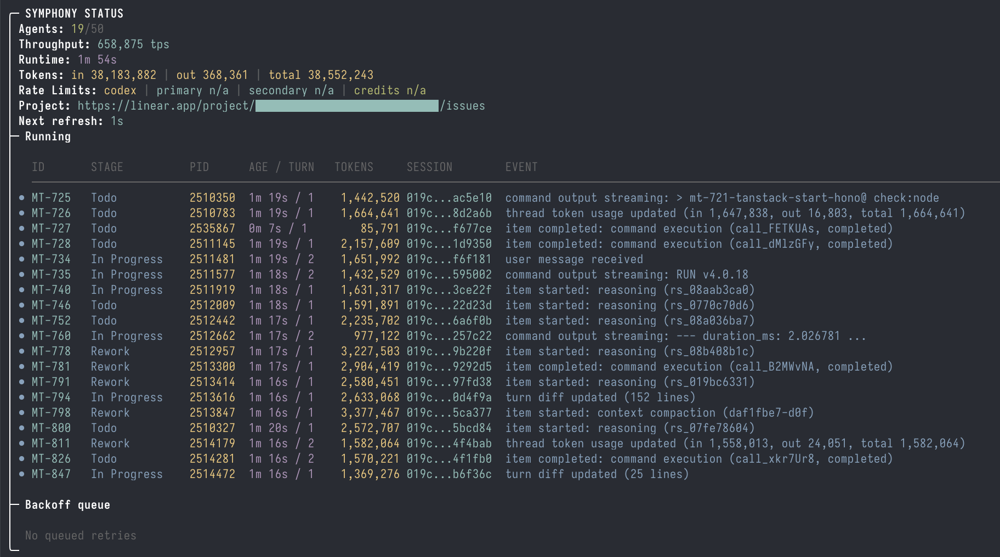

> GH-1 / IS-025：`mvp.max_rework` 默认 0，显式 1..5 开启检查与 Review 共用预算的有限返工；完整日志和外部 formatter 的结构化 ExUnit 报告本地保留，Review 拒绝理由回帖。普通及自定义断言可返工；未知检查错误、环境故障、缺失或矛盾报告、评论不确定或运行中断即停止。`mix mvp.reconcile` 仅只读对账，不恢复执行。`Executor.recheck/3` 仅供可信操作者在明确授权、原回执摘要和完整性核对后复检，执行级互斥与前序终态审计保护历史，已用次数不重置，轮询不会自动恢复 blocked。外部新版 `check_baseline.py` 通过 `--baseline` 显式指定原冻结快照；检查命令可用 `--evidence-root "{evidence}"` 将完整报告保存在本轮证据目录。逐轮证据、Review schema、用量未知值和测试对应见 [REVIEW_REWORK.md](../docs/REVIEW_REWORK.md)。

## 本机 VM 运行合同（2026-10-21）

当前 GitLab 项目为 `innovation/luca`，单仓库、单任务。控制器以 guest 系统服务运行固定 release `9cf6c1701f26-20261021`，活动配置在 `/var/lib/innovation-symphony/WORKFLOW.md`，运行根在 `/var/tmp/innovation-symphony-linux-runtime`；不要启动下方上游 Linear 示例或旧宿主容器作为第二个执行者。当前运维和版本见 [VM_DEPLOYMENT](../docs/VM_DEPLOYMENT.md) 与 [运维入口](../scripts/vm/README.md)。

显式 `required_backend: vm` 核验固定 VM UUID、模型准备、管理员能力探针、目录及磁盘；`mvp.sandbox.enabled: false` 表示外层 VM 隔离，coder 使用 approval_policy=never / danger-full-access，Reviewer/诊断使用独立只读会话。VM 内 sudo 与 Docker 完全放权，不能宣称内部凭据或检查证据不受任务影响；rootless 旧合同继续独立保留。

新任务 recovery 配置为 enabled=true、max_rework=30、max_agent_attempts=96、max_elapsed_ms=14400000、diagnose_every=3、stage_attempts=3、resume_on_restart=true。正式检查上限 1800000 ms，同时受剩余任务预算约束；Reviewer 收到准确候选、轮次与 attempt 的完整结束检查证据。重启不重置预算，旧 blocked 任务不自动复活，未知用量和无法唯一对账的远端写入保守停止。恢复细节见 [AUTOMATIC_RECOVERY](../docs/AUTOMATIC_RECOVERY.md)。

原生工具链为 OTP 28.5.0.7、Elixir 1.19.6、Codex 0.163.0（主程序和相邻 helper 均核验摘要）；完整门禁为仓库根执行 `sudo bash scripts/vm/check-native.sh /absolute/source`，内部仍运行 elixir 下原有 `make all`。上一同运行代码全门禁为 996 项零失败、6 项显式跳过、100% 覆盖率与 Dialyzer 零错误；本次文档同步没有重跑该门禁或重新调用模型。下文 GH-1/旧接续和上游说明保留其适用范围，0..5 并非当前 VM recovery 的上限。

> 本项目基于官方 Symphony 固定提交扩展，来源见 [UPSTREAM.md](../docs/UPSTREAM.md)。下方保留上游运行说明。`WORKFLOW.github.example.md` 是默认停用的 GitHub MVP 示例，`WORKFLOW.gitlab.example.md` 是对应的 GitLab 示例（实例、项目路径、token 与可选 CA 均以环境引用填写，见 [GITLAB_INTEGRATION.md](../docs/GITLAB_INTEGRATION.md)）；使用前填写仓库、用户/模型允许名单及独立路径；`mix mvp.check /absolute/WORKFLOW.md` 仅本地检查，不启动轮询。新增配置、恢复限制及人工交接见 [IMPLEMENTATION_V0.md](../docs/IMPLEMENTATION_V0.md)。不要使用旧 Linear 示例的自动合并流程。

GH-3 新增 escript `--preflight`：保留 guardrails acknowledgement 参数，只读校验已启用的 GitHub MVP 配置并查询任务列表，不启动 Symphony 运行监督器，成功输出 JSON 后退出。使用方式及外部超时要求见 [OPERATIONS.md](../docs/OPERATIONS.md#gh-3-只读体检)；完整接棒、自动回退尚未实现。

GH-5 的同一打包 escript 提供 `--watchdog run|start|pause|resume|recover|status CONFIG.json`。该入口不启动 Symphony 监督器；值守作为独立 OS 进程运行，以固定安装指针、持久维护锁、每版本启动预算和宿主进程身份决定是否拉起运行器。配置格式、非交互凭据来源与人工命令见 [OPERATIONS.md](../docs/OPERATIONS.md#看门狗维护流程)。

体检要求 `tracker.active_states` 非空且只能包含 `open`（忽略首尾空白与大小写）。空列表以及包含 `closed`、`ready`、`all` 等其他状态的列表会失败；只有远端查询成功后的空队列才可通过。体检会拒绝任意页中的畸形任务记录，普通轮询仍沿用丢弃畸形记录的兼容行为。

# Symphony Elixir

IS-033 新增显式 `mvp.sandbox`：在 Linux bubblewrap/cgroup 环境内执行 coder 自检与正式检查，宿主保留模型连接，任务使用 Codex stdio execution environment；未启用时保留兼容行为。所需路径、离线依赖、资源参数和审计恢复见 [CODER_EXECUTION_RULES.md](../docs/CODER_EXECUTION_RULES.md)。支持该能力的 Codex、bubblewrap 与 cgroup 必须先验收，失败不得自动回到宿主执行。

GitHub MVP 的 `mvp.enabled=false` 只暂停新领取；完整执行合同仍校验和保留，已领取任务可通过受信 `mvp.external` 入口补证接续。入口仍要求当前 ready 授权、冻结模型／服务和检查一致，不会自动恢复任务。隔离 Agent 时限取剩余任务预算与单次模型执行上限的较小值，独立于正式检查超时；非法时限在准备环境前拒绝。历史未产出轮只在原始回执与闭合操作者审计链一致时接受，同一 Draft 的候选修订必须为快进且满足准确远端引用租约。当前审查和验证见 [VALIDATION_LINUX_PATCHES](../docs/VALIDATION_LINUX_PATCHES.md)。

GitHub MVP 每轮派发前校验 MVP 配置；错误记录为 `MVP dispatch disabled by invalid configuration`，修正工作流后下一轮重新校验。escript 的运行路径边界使用解析符号链接后的实际工件所在目录；普通 OTP/Mix 运行仍使用应用目录。启动验收须覆盖打包产物的 ready 候选门槛，不能仅检查 HTTP 或 `mix mvp.check`。

This directory contains the current Elixir/OTP implementation of Symphony, based on
[`SPEC.md`](../SPEC.md) at the repository root.

> [!WARNING]
> Symphony Elixir is prototype software intended for evaluation only and is presented as-is.
> We recommend implementing your own hardened version based on `SPEC.md`.

## Screenshot



## How it works

1. Polls the configured tracker for candidate work (included adapters: Linear, GitHub Issues, Jira
   Cloud, Asana, and GitLab)
2. Creates a workspace per issue
3. Launches Codex in [App Server mode](https://developers.openai.com/codex/app-server/) inside the
   workspace
4. Sends a workflow prompt to Codex
5. Keeps Codex working on the issue until the work is done

During app-server sessions, the selected tracker adapter may advertise provider-native tools. The
Linear serves `linear_graphql`, GitHub Issues serves `github_api`, Jira Cloud serves
`jira_rest`, Asana serves `asana_api`, and GitLab serves `gitlab_api`. Symphony executes those
tools with configured host-side auth and removes declared tracker-token environment variables from
the Codex child, so the agent does not need a second tracker login.

If a claimed issue moves to a terminal state (`Done`, `Closed`, `Cancelled`, or `Duplicate`),
Symphony stops the active agent for that issue and cleans up matching workspaces.

If Codex reports that operator input, approval, or MCP elicitation is required, Symphony keeps the
issue claimed and exposes it as blocked in the runtime state, JSON API, and dashboard. Blocked
entries are in memory only; restarting the orchestrator clears that blocked map, so any still-active
tracker issue can become a dispatch candidate again after restart.

## How to use it

1. Make sure your codebase is set up to work well with agents: see
   [Harness engineering](https://openai.com/index/harness-engineering/).
2. Get a new personal token in Linear via Settings → Security & access → Personal API keys, and
   set it as the `LINEAR_API_KEY` environment variable.
3. Copy this directory's `WORKFLOW.md` to your repo.
4. Optionally copy the `commit`, `push`, `pull`, `land`, and `linear` skills to your repo.
   - The `linear` skill expects Symphony's `linear_graphql` app-server tool for raw Linear GraphQL
     operations such as comment editing or upload flows.
5. Customize the copied `WORKFLOW.md` file for your project.
   - To get your project's slug, right-click the project and copy its URL. The slug is part of the
     URL.
   - When creating a workflow based on this repo, note that it depends on non-standard Linear
     issue statuses: "Rework", "Human Review", and "Merging". You can customize them in
     Team Settings → Workflow in Linear.
6. Follow the instructions below to install the required runtime dependencies and start the service.

## Prerequisites

We recommend using [mise](https://mise.jdx.dev/) to manage Elixir/Erlang versions.

```bash
mise install
mise exec -- elixir --version
```

## Run

```bash
git clone https://github.com/openai/symphony
cd symphony/elixir
mise trust
mise install
mise exec -- mix setup
mise exec -- mix build
mise exec -- ./bin/symphony ./WORKFLOW.md
```

## Burrito releases

Symphony ships self-contained executables built with
[Burrito](https://github.com/burrito-elixir/burrito). They embed Erlang/OTP, Elixir, and Symphony,
but still expect `codex`, `git`, and the selected tracker credentials on the target machine.

Supported release targets:

- `macos_arm64`
- `macos_x86_64`
- `linux_arm64`
- `linux_x86_64`

`v*` tags publish all four targets with checksums. A manual workflow run builds the same
artifacts without creating a release.

The `burrito-nightly` workflow builds each push to `main`, with no scheduled rebuilds.
After all four platform smoke tests pass, it updates the rolling
[`nightly` prerelease](https://github.com/openai/symphony/releases/tag/nightly),
including binaries and checksums. Nightly binaries use a `-nightly` version suffix;
the release notes identify the source commit. Stable releases remain unchanged.

After downloading the executable for your platform from a release:

```bash
chmod +x ./symphony-v0.0.1-macos_arm64
./symphony-v0.0.1-macos_arm64 ./WORKFLOW.md
```

## Configuration

Pass a custom workflow file path to `./bin/symphony` when starting the service:

```bash
./bin/symphony /path/to/custom/WORKFLOW.md
```

If no path is passed, Symphony defaults to `./WORKFLOW.md`.

Optional flags:

- `--logs-root` tells Symphony to write logs under a different directory (default: `./log`)
- `--port` also starts the Phoenix observability service (default: disabled)

The `WORKFLOW.md` file uses YAML front matter for configuration, plus a Markdown body used as the
Codex session prompt.

Minimal example:

```md
---
tracker:
  kind: linear
  provider:
    project_slug: "..."
workspace:
  root: ~/code/workspaces
hooks:
  after_create: |
    git clone git@github.com:your-org/your-repo.git .
agent:
  max_concurrent_agents: 10
  max_turns: 20
codex:
  command: codex app-server
---

You are working on an issue from the configured tracker {{ issue.identifier }}.

Title: {{ issue.title }} Body: {{ issue.description }}
```

Notes:

- If a value is missing, defaults are used.
- `tracker.kind` selects an adapter. Adapter-owned endpoint, scope, and auth settings belong under
  `tracker.provider`; the current Linear adapter still accepts the older flat `endpoint`,
  `api_key`, `project_slug`, and `assignee` aliases for compatibility.
- `tracker.required_labels` is optional. When set, an issue must have every
  configured label to dispatch or continue running. Label matching ignores
  case and surrounding whitespace. A blank configured label matches no issue.
- Safer Codex defaults are used when policy fields are omitted:
  - `codex.approval_policy` defaults to `{"reject":{"sandbox_approval":true,"rules":true,"mcp_elicitations":true}}`
  - `codex.thread_sandbox` defaults to `workspace-write`
  - `codex.turn_sandbox_policy` defaults to a `workspaceWrite` policy rooted at the current issue workspace
- `codex.turn_timeout_ms` is the maximum silence interval while a turn is streaming. Each
  app-server update resets it; it is not a total turn runtime cap.
- Supported `codex.approval_policy` values depend on the targeted Codex app-server version. In the current local Codex schema, string values include `untrusted`, `on-failure`, `on-request`, and `never`, and object-form `reject` is also supported.
- Supported `codex.thread_sandbox` values: `read-only`, `workspace-write`, `danger-full-access`.
- When `codex.turn_sandbox_policy` is set explicitly, Symphony passes the map through to Codex
  unchanged. Compatibility then depends on the targeted Codex app-server version rather than local
  Symphony validation.
- Workflows that run package managers or other commands that resolve external hosts should set
  `networkAccess: true` in `codex.turn_sandbox_policy`; otherwise DNS/network access may be denied
  by the Codex turn sandbox.
- `agent.max_turns` caps how many back-to-back Codex turns Symphony will run in a single agent
  invocation when a turn completes normally but the issue is still in an active state. Default: `20`.
- If the Markdown body is blank, Symphony uses a default prompt template that includes the issue
  identifier, title, and body.
- Use `hooks.after_create` to bootstrap a fresh workspace. For a Git-backed repo, you can run
  `git clone ... .` there, along with any other setup commands you need.
- If a hook needs `mise exec` inside a freshly cloned workspace, trust the repo config and fetch
  the project dependencies in `hooks.after_create` before invoking `mise` later from other hooks.
- For the Linear adapter, `tracker.provider.api_key` reads from `LINEAR_API_KEY` when unset or
  when value is `$LINEAR_API_KEY`. The legacy flat `tracker.api_key` alias behaves the same way.
- Do not put a literal tracker token in a repo-owned `WORKFLOW.md` if Codex can read that
  workspace. Use `$VAR`/host-side secret references so Symphony can keep the token out of the
  child environment.
- For path values, `~` is expanded to the home directory.
- For env-backed path values, use `$VAR`. `workspace.root` resolves `$VAR` before path handling,
  while `codex.command` stays a shell command string and any `$VAR` expansion there happens in the
  launched shell.

```yaml
tracker:
  provider:
    api_key: $LINEAR_API_KEY
workspace:
  root: $SYMPHONY_WORKSPACE_ROOT
hooks:
  after_create: |
    git clone --depth 1 "$SOURCE_REPO_URL" .
codex:
  command: "$CODEX_BIN --config 'model=\"gpt-5.5\"' app-server"
```

- If `WORKFLOW.md` is missing or has invalid YAML at startup, Symphony does not boot.
- If a later reload fails, Symphony keeps running with the last known good workflow and logs the
  reload error until the file is fixed.
- `server.port` or CLI `--port` enables the optional Phoenix LiveView dashboard and JSON API at
  `/`, `/api/v1/state`, `/api/v1/<issue_identifier>`, and `/api/v1/refresh`.

### Linear adapter profile

- Config: use `tracker.kind: linear` with `tracker.provider.endpoint` (default
  `https://api.linear.app/graphql`), `api_key` (defaults to `LINEAR_API_KEY` and accepts
  `$VAR`), required `project_slug`, and optional `assignee` (a Linear user ID or `me`,
  defaulting to `LINEAR_ASSIGNEE`).
  The legacy flat `tracker.endpoint`, `api_key`, `project_slug`, and `assignee` aliases remain
  supported. `required_labels`, `active_states`, and `terminal_states` stay under `tracker`.
- Scope and paging: candidate reads filter the configured project slug and requested state names,
  following Linear pages of 50. ID refreshes are also project-scoped and batch up to 50 IDs. Empty
  state/ID lists return `{:ok, []}` without a Linear request.
- Identity and normalization: `issue.id` is the Linear issue ID and `issue.native_ref` is currently
  `nil`. Records missing a nonblank ID, identifier, title, or state are dropped from candidate
  pages and fail ID refreshes. State keeps Linear's spelling; integer priorities are preserved and
  other priority values become `nil`; RFC 3339 timestamps are parsed and unusable timestamps become
  `nil`. Labels are trimmed, lowercased, deduplicated, and blanks are dropped; blockers come from
  inverse `blocks` relations.
- Dispatchability: the adapter marks an issue dispatchable only when optional assignee routing
  matches and a `Todo` issue has no non-terminal blocker. The generic scheduler then applies
  active/terminal states, required labels, claims, retries, and concurrency.
- Tool: the Linear adapter advertises `linear_graphql`, accepting either a raw query string or an
  object with nonblank `query` and optional object `variables`. Symphony executes it host-side
  with the session-bound endpoint/token and strips declared token environment variables from the
  Codex child. `project_slug` scopes scheduler reads, not raw tool calls; the tool can access
  whatever the configured Linear token can access.
- Responsibility and errors: `linear_graphql` adds no idempotency key, retry, scope guard, or
  rate-limit policy, so workflows own idempotent mutations and handling provider errors. Read/config
  failures use `{:error, :missing_linear_api_token}`, `{:error, :missing_linear_project_slug}`,
  `{:error, :invalid_linear_endpoint}`, `{:error, :invalid_linear_assignee}`,
  `{:error, :missing_linear_viewer_identity}`, `{:error, {:linear_api_status, status}}`,
  `{:error, {:linear_api_request, reason}}`, `{:error, {:linear_graphql_errors, errors}}`,
  `{:error, :linear_unknown_payload}`, or `{:error, :linear_missing_end_cursor}`. Tool results
  are maps with `"success"`, JSON-string `"output"`, and text `"contentItems"`; invalid
  arguments, missing auth, and transport failures return `"success" => false` with
  `{"error": {"message": ...}}`, while top-level GraphQL errors preserve the response body with
  `"success" => false`.
  For portable reporting, map missing/invalid token, project, endpoint, assignee, or viewer errors
  to `tracker_config` or `tracker_auth`, request failures to `tracker_transport`, non-200 responses to
  `tracker_response` (`429` is `tracker_rate_limited`), GraphQL/unknown payload failures to
  `tracker_payload`, and missing cursors to `tracker_pagination`; logs and tool responses carry the
  human-readable provider detail.

### GitHub Issues adapter

- Config: use `tracker.kind: github` with required `tracker.provider.repo` in `owner/repo` form,
  optional `token` (defaults to `GITHUB_TOKEN` and accepts `$VAR`), and optional `api_url`
  (default `https://api.github.com`, HTTPS only). Set explicit `active_states` and
  `terminal_states`; active entries may be `open` and terminal entries may be `closed`.
- Reads and identity: polling is scoped to the configured repository; `issue.id` is the
  repository issue number, `issue.identifier` is `GH-<number>`, hidden or deleted `404` issues are
  omitted on refresh, and pull requests returned by the Issues API are not dispatchable.
- Tool and auth: `github_api` accepts a relative REST `path` plus optional `params` and JSON
  `body`; Symphony executes it host-side with the session-bound token, removes configured tracker
  credentials and provider authentication aliases from the Codex child, and leaves raw tool access
  limited by that token's GitHub permissions.

### Jira Cloud adapter

- Config: use `tracker.kind: jira` with provider `base_url`, `email`, `api_token`, and required
  `project_key`; the first three default to `JIRA_BASE_URL`, `JIRA_EMAIL`, and `JIRA_API_TOKEN`
  and accept `$VAR`. Set explicit Jira-native `active_states` and `terminal_states`.
- Issues and reads: candidate reads and ID refreshes stay scoped to the configured project and
  requested statuses; `issue.id` is Jira's immutable ID and `issue.identifier` is the issue key.
- Blockers: inward `Blocks` links populate `blocked_by`; issues in Jira's `new` status category
  wait until blockers reach configured terminal states, while in-progress categories keep running.
- Tool: `jira_rest` sends relative `/rest/api/3/` requests host-side with configured Basic auth,
  strips token environment variables from Codex, and can reach whatever the Jira credential can.

### Asana adapter

- Config: use `tracker.kind: asana` with required `tracker.provider.project_gid`, optional
  `endpoint` (default `https://app.asana.com/api/1.0`), and `api_key` (defaults to `ASANA_PAT` and
  accepts `$VAR`); `active_states` and `terminal_states` are project section names.
- Scope: Symphony polls tasks in the configured project, treats their section as state, and omits
  deleted or out-of-project tasks during ID refreshes.
- Tool: `asana_api` sends relative Asana REST requests host-side with the configured auth; Symphony
  strips `ASANA_PAT` and configured token variables from the Codex child, while raw tool calls are
  not limited to the configured project.

### GitLab adapter

- Configure `tracker.kind: gitlab` with `tracker.provider.project_path`, optional `api_url`, and
  `api_key` (default `GITLAB_PAT`); use `opened` and `closed` tracker states.
- Symphony reads project issues by IID and exposes route-safe `GL-<iid>` identifiers.
- `gitlab_api` forwards raw GitLab REST requests with host-side auth and keeps configured tracker
  credentials and provider authentication aliases out of the Codex child.

## Web dashboard

The observability UI now runs on a minimal Phoenix stack:

- LiveView for the dashboard at `/`
- JSON API for operational debugging under `/api/v1/*`
- Bandit as the HTTP server
- Phoenix dependency static assets for the LiveView client bootstrap
- Tracker issue identifiers link to the tracker-provided URL when it uses `http` or `https`

## Project Layout

- `lib/`: application code and Mix tasks
- `test/`: ExUnit coverage for runtime behavior
- `WORKFLOW.md`: in-repo workflow contract used by local runs
- `../.codex/`: repository-local Codex skills and setup helpers

## Testing

The default suite includes real Codex client configuration tests. They use synthetic
credentials and do not run model inference or require a real account. Set
`SYMPHONY_TEST_CODEX` to an executable client path; otherwise the tests look for
`codex` on `PATH`, then `/opt/codex`. CI provisions Codex CLI `0.160.0` from the
official Linux x86_64 release, verifies its pinned SHA-256 and version, and exports
the explicit path before running the checks. A missing client is a test failure.

```bash
export SYMPHONY_TEST_CODEX=/absolute/path/to/codex
make all
```

Run the real external end-to-end test only when you want Symphony to create disposable Linear
resources and launch a real `codex app-server` session:

```bash
cd elixir
export LINEAR_API_KEY=...
make e2e
```

Optional environment variables:

- `SYMPHONY_LIVE_LINEAR_TEAM_KEY` defaults to `SYME2E`
- `SYMPHONY_LIVE_SSH_WORKER_HOSTS` uses those SSH hosts when set, as a comma-separated list

`make e2e` runs two live scenarios:
- one with a local worker
- one with SSH workers

If `SYMPHONY_LIVE_SSH_WORKER_HOSTS` is unset, the SSH scenario uses `docker compose` to start two
disposable SSH workers on `localhost:<port>`. The live test generates a temporary SSH keypair,
mounts the host `~/.codex/auth.json` into each worker, verifies that Symphony can talk to them
over real SSH, then runs the same orchestration flow against those worker addresses. This keeps
the transport representative without depending on long-lived external machines.

Set `SYMPHONY_LIVE_SSH_WORKER_HOSTS` if you want `make e2e` to target real SSH hosts instead.

The live test creates a temporary Linear project and issue, writes a temporary `WORKFLOW.md`, runs
a real agent turn, verifies the workspace side effect, requires Codex to comment on and close the
Linear issue, then marks the project completed so the run remains visible in Linear.

Run the opt-in GitHub Issues live test with a disposable/scratch repository:

```bash
cd elixir
export SYMPHONY_LIVE_GITHUB_REPO=owner/scratch-repo
export GITHUB_TOKEN=...
SYMPHONY_RUN_GITHUB_LIVE_E2E=1 mix test test/symphony_elixir/github_live_e2e_test.exs
```

Run the opt-in Jira Cloud live test against a disposable project whose credential can browse,
create, comment on, transition, and delete issues:

```bash
cd elixir
export JIRA_BASE_URL=https://your-site.atlassian.net
export JIRA_EMAIL=...
export JIRA_API_TOKEN=...
export SYMPHONY_LIVE_JIRA_PROJECT_KEY=TEST
SYMPHONY_RUN_JIRA_LIVE_E2E=1 mix test test/symphony_elixir/jira_live_e2e_test.exs
```

Run the opt-in Asana live E2E against disposable Asana resources:

```bash
cd elixir
export ASANA_PAT=...
export SYMPHONY_LIVE_ASANA_WORKSPACE_GID=...
# Required only when the workspace is an organization:
# export SYMPHONY_LIVE_ASANA_TEAM_GID=...
SYMPHONY_RUN_ASANA_LIVE_E2E=1 mix test test/symphony_elixir/asana_live_e2e_test.exs
```

Run the opt-in GitLab live E2E against a disposable project:

```bash
cd elixir
export GITLAB_PAT=...
export SYMPHONY_LIVE_GITLAB_PROJECT_ID=...
SYMPHONY_RUN_GITLAB_LIVE_E2E=1 mix test test/symphony_elixir/gitlab_live_e2e_test.exs
```

## FAQ

### Why Elixir?

Elixir is built on Erlang/BEAM/OTP, which is great for supervising long-running processes. It has an
active ecosystem of tools and libraries. It also supports hot code reloading without stopping
actively running subagents, which is very useful during development.

### What's the easiest way to set this up for my own codebase?

Launch `codex` in your repo, give it the URL to the Symphony repo, and ask it to set things up for
you.

## License

This project is licensed under the [Apache License 2.0](../LICENSE).

### GH-12 role model services

The optional `mvp.model_services` registry separates coder/reviewer provider, model,
parameters, connection and credential references. Local management uses
`mix mvp.models`; persisted state overrides the workflow seed and is loaded for
new claims. Tasks retain full service snapshots through retry and audited recovery.
Each invocation reads current authorization from the task's bound workflow and
original persistent registry; revoked access or unreadable authorization stops the
call without replacing frozen routing or using the workflow store's stale cache.
See [MODEL_SERVICES](../docs/MODEL_SERVICES.md) for schema, discovery versus
capability evidence, administrator commands, legacy migration and rollback.
Terminal historical receipts can be enriched with `mix mvp.models migrate` using
explicit historical routing and current role evidence under the existing audit lock;
this does not resume execution or add budget. Unsupported legacy Codex settings
stop with a migration error instead of adopting a new address or effort.
No network configuration write endpoint or View settings page is introduced.


实验性的宽权限 rootless 容器、持久导出、失败分流和固定补证配置见 [实施合同](../docs/ROOTLESS_OPEN.md)。默认未启用；代码不代表已安装或实机验收，旧冻结任务保持原后端。

GH-16 新增独立 escript `--model-settings CONFIG.json` 管理入口，仅启动 loopback HTTP
管理服务，不启动 Symphony 调度监督器。复用 ModelServices 的仓库默认 CAS、角色
授权与冻结，并增加 DeepSeek Responses 路由；运行配置和迁移见
[VIEW_MODEL_SETTINGS](../docs/VIEW_MODEL_SETTINGS.md)。安装／内网代理仍须具体授权。
